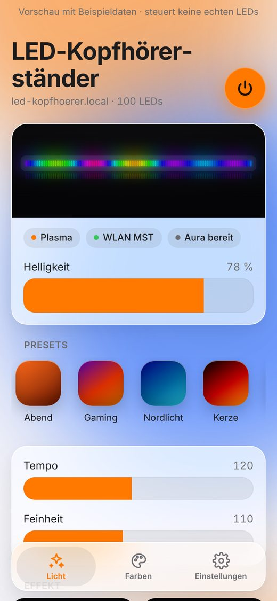
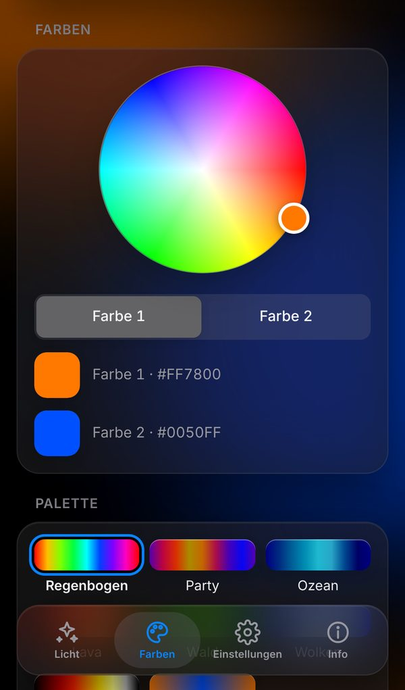
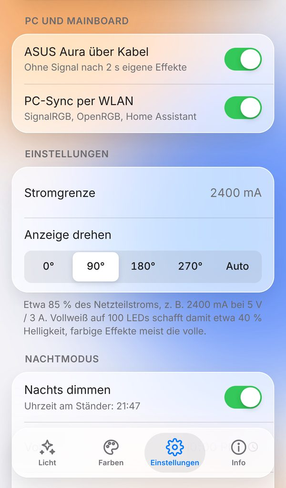
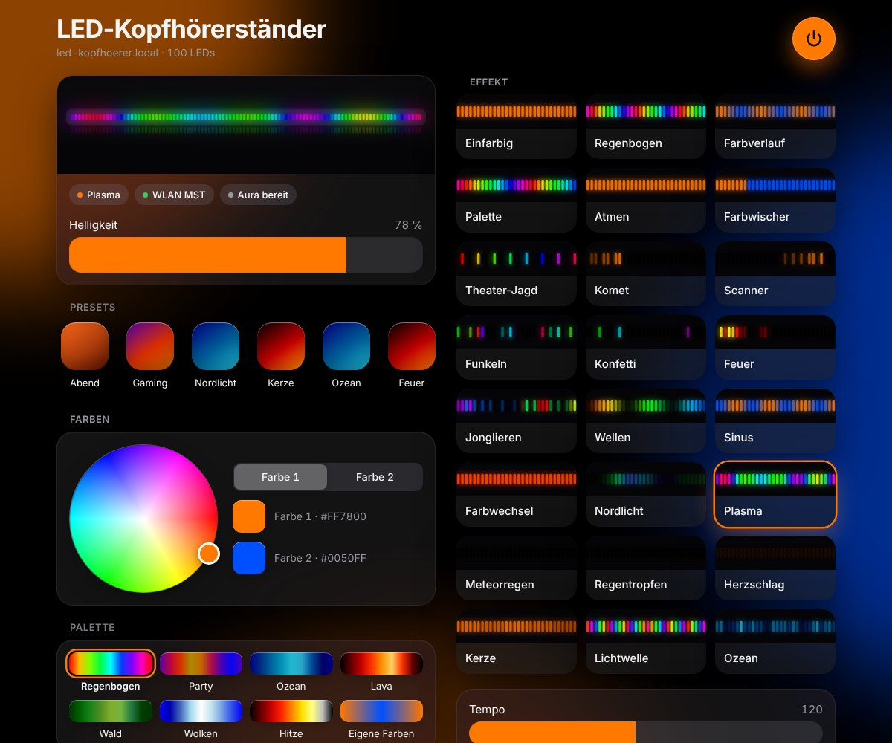

# ESP32-LED-Kopfhoererstaender

WLAN-Steuerung für die LED-Beleuchtung eines Kopfhörerständers. Ein Waveshare ESP32-C6-Touch-LCD-1.9 steuert einen WS2812B-Streifen (5 V, 144 LEDs, 1 m). Über eine Weboberfläche im Heimnetz wählst du Farben, Paletten und bewegte Effekte, ähnlich wie bei WLED. Das eingebaute Display zeigt IP-Adresse, Effekt, Helligkeit und eine LED-Vorschau. Tippen in die obere Hälfte oder Wischen nach rechts schaltet zum nächsten Effekt, Wischen nach links zum vorherigen. Tippen in die untere Hälfte wechselt die Farbe (bei Farbeffekten wie Einfarbig) oder sonst die Palette.

  
  
  

  

Die Weboberfläche hat drei Seiten, zwischen denen die Leiste unten umschaltet: **Licht** (Presets, Effekte, Tempo), **Farben** (Farbrad, Paletten) und **Einstellungen** (ASUS Aura, PC-Sync, Matter, Stromgrenze, Display-Drehung mit „Auto“ über den Lagesensor, Gerätedaten, WLAN). Kopfzeile mit Ein/Aus, Live-Streifen und Helligkeit bleiben auf jeder Seite oben. Jede Seite hat eine eigene Adresse (`#licht`, `#farben`, `#einst`), und der Browser merkt sich die zuletzt offene.

Die Bilder zeigen die Weboberfläche mit Beispieldaten. Eine klickbare Vorschau ohne Gerät ist `web/index.html` mit `window.LED_DEMO = true`.

## Hardware

| Bauteil | Anschluss |
|---|---|
| ESP32-C6-Touch-LCD-1.9 | VBUS-Pin über Schottky-Diode 1N5819, GND, **GPIO3 = LED-Daten**, **GPIO23 = ARGB-Eingang** |
| ARGB-Kabel vom Mainboard | D über 1 kΩ / 2 kΩ an GPIO23, G an GND, 5V frei |
| 74AHCT125 | Pegelwandler 3,3 V → 5 V (Kanal 1), 100 nF an Pin 14 |
| WS2812B | DIN über 330 Ω, +5 V/GND direkt vom Netzteil |
| Netzteil | USB-C-Netzteil 5 V / 3 A über USB-C-Buchse mit 5,1-kΩ-CC-Widerständen, Stromgrenze 2400 mA |

Beim ESP32-C6-Touch-LCD-1.9 sind GPIO1 und GPIO2 mit der Lagesensor-IMU verbunden. Deshalb liegen LED-Daten und ARGB-Eingang hier auf **GPIO3** (Leiste mit 1, 2, 3) und **GPIO23** (Leiste mit 22, 23). Das alte ESP32-C6-LCD-1.3 nutzt weiter GPIO1 und GPIO2, siehe `env:esp32-c6-lcd-13`.

Schaltplan, Breadboard-Belegung und Bauteilliste: [`docs/hardware/schaltung.html`](docs/hardware/schaltung.html). Die Zeichnung zeigt das ESP32-C6-Touch-LCD-1.9 (VBUS = J4 Pin 1, GPIO3 = J3 Pin 7, GPIO23 = J4 Pin 9). Im Browser öffnen. Die Seite wird mit `python3 docs/hardware/gen_schaltung.py` aus der Vorlage neu erzeugt.

## Bauen und flashen

Voraussetzung: VS Code mit PlatformIO.

1. Repo mit Fork klonen, z. B. nach `K:\Fork-GitHub\ESP32-LED-Kopfhoererstaender`.
2. Den Ordner in VS Code öffnen. PlatformIO lädt beim ersten Bauen die Plattform `pioarduino` (Arduino-Core 3.x für den ESP32-C6) und die Bibliotheken FastLED und GFX Library for Arduino.
3. Board per USB-C anschließen, **Upload** in der PlatformIO-Leiste klicken.
4. Serieller Monitor mit 115200 Baud zeigt Verbindung und IP-Adresse.

Es gibt zwei Umgebungen, auswählbar unten in der VS-Code-Statusleiste:

| Umgebung | Inhalt | Update per WLAN |
|---|---|---|
| `esp32-c6-lcd` (Standard) | alles, mit Matter für Apple Home & Co. | möglich, siehe unten |
| `esp32-c6-lcd-13` | für das alte ESP32-C6-LCD-1.3 (4 MB), ohne Matter | möglich |

Die Partitionstabelle (`partitions_8mb.csv` bzw. `partitions.csv` beim 1.3er) wird nur per USB geschrieben. Nach dem Wechsel auf eine neue Tabelle deshalb einmal per USB flashen. Die Einstellungen und WLAN-Daten liegen in beiden Tabellen an derselben Stelle und bleiben erhalten.

Das USB-C-Netzteil für die LEDs darf beim Flashen angeschlossen sein. Die Diode verhindert, dass es in den USB-Anschluss zurückspeist.

## Erste Einrichtung (WLAN)

Die WLAN-Zugangsdaten stehen nicht im Code.

1. Beim ersten Start öffnet der Controller das WLAN **`LED-Kopfhoerer-Setup`** (ohne Passwort). Das Display zeigt das an.
2. Mit dem Handy verbinden. Die Einrichtungsseite öffnet sich meist von selbst, sonst `http://192.168.4.1` aufrufen.
3. Heim-WLAN wählen, Passwort eingeben, **Speichern und verbinden**. Der Controller startet neu.
4. Danach erreichst du die Steuerung unter **http://led-kopfhoerer.local** oder der IP-Adresse auf dem Display.

Findet der Controller das gespeicherte WLAN nach dem Einschalten 20 Sekunden lang nicht, öffnet er zusätzlich wieder das Einrichtungs-WLAN.

## Bedienung

- **Weboberfläche:** Live-Vorschau des Streifens, Ein/Aus, Helligkeit, Presets, Farbrad für zwei Farben, Paletten, Effekte mit animierter Vorschau, Tempo, Intensität, Aura und PC-Sync, Stromgrenze, Anzeige drehen, WLAN neu einrichten. Hell- und Dunkelmodus folgen dem Gerät. Auf dem iPhone lässt sich die Seite über *Teilen → Zum Home-Bildschirm* wie eine App ablegen.
- **Presets:** Tippen lädt ein Preset, „Speichern“ legt die aktuelle Einstellung als neues an (bis zu 12). Gedrückt halten bzw. Rechtsklick löscht eins. Presets liegen im Flash des Controllers und gelten für alle Geräte im Heimnetz.
- **BOOT-Taster kurz drücken, in die obere Displayhälfte tippen oder nach rechts wischen:** nächster Effekt. **Nach links wischen:** vorheriger Effekt. **In die untere Hälfte tippen:** nächste Farbe bei Farbeffekten (Einfarbig, Atmen, Komet, Kerze ...), sonst nächste Palette. Oben, unten, links und rechts gelten im angezeigten Bild, also passend zur Drehung.
- **BOOT-Taster 5 s halten:** WLAN-Daten löschen, Neustart ins Einrichtungs-WLAN.
- **Anzeige drehen** (Einstellungen): 0° und 180° ergeben Hochformat, 90° und 270° Querformat, passend zur Gehäusevariante. Die Anzeige ordnet sich selbst neu an.

Alle Einstellungen werden etwa 3 Sekunden nach der letzten Änderung gespeichert und nach einem Neustart wiederhergestellt.

### Effekte

| Effekt | Farben | Intensität bedeutet |
|---|---|---|
| Einfarbig | Farbe 1 | – |
| Regenbogen | – | Anzahl Regenbögen |
| Farbverlauf | Farbe 1 → 2 | Anzahl Wiederholungen |
| Palette | Palette | Dichte |
| Atmen | Farbe 1 | – |
| Farbwischer | Farbe 1 und 2 | – |
| Theater-Jagd | Palette | Abstand |
| Komet | Farbe 1 | Schweiflänge |
| Scanner | Farbe 1 und 2 | Schweiflänge |
| Funkeln | Palette | Häufigkeit |
| Konfetti | Palette | Menge |
| Feuer | Glut-Farben | Flammenhöhe |
| Jonglieren | Palette | Anzahl Punkte |
| Wellen | Palette | Wellengröße |
| Sinus | Farbe 1 und 2 | Frequenz |
| Farbwechsel | Palette | – |
| Nordlicht | eigene Grün-Violett-Töne | Kontrast |
| Plasma | Palette | Feinheit |
| Meteorregen | Palette | Anzahl Meteore |
| Regentropfen | Palette | Häufigkeit |
| Herzschlag | Farbe 1 | Ausbreitung |
| Kerze | Farbe 1 (warm wählen) | Flackern |
| Lichtwelle | Palette | Dichte |
| Ozean | eigene Blautöne | Schaum |

Tempo 0 hält bewegte Effekte an. Die Palette „Eigene Farben“ nutzt Farbe 1 und 2.

## ASUS Aura über das Mainboard-Kabel

Der Ständer kann direkt von Armoury Crate/Aura gesteuert werden, ohne Zusatzsoftware. Dafür liest der ESP das Signal eines ARGB-Headers auf dem Mainboard mit. Für Aura ist der Ständer dann ein ganz normaler ARGB-Streifen.

**Anschluss** (siehe `docs/hardware/schaltung.html`):
- Header-Pin **D** → R3 1 kΩ → **GPIO23**, von GPIO23 → R4 2 kΩ → GND (beim alten 1.3er GPIO2). Der Spannungsteiler macht aus 5 V etwa 3,3 V.
- Header-Pin **G** → GND des Aufbaus.
- Header-Pin **5V** bleibt frei. Die LEDs bekommen ihren Strom weiter vom eigenen Netzteil.

**In Armoury Crate:** Im Aura-Bereich die LED-Anzahl für den ARGB-Anschluss einstellen oder erkennen lassen. Die Firmware erkennt die Anzahl, die das Mainboard sendet (bis 300), und streckt sie auf 144 LEDs. Erlaubt Aura 144 LEDs, entspricht jede Aura-LED genau einer LED am Ständer. Viele Boards begrenzen auf weniger, dann übernimmt eine Aura-LED mehrere Ständer-LEDs.

**Verhalten:** Sendet das Mainboard, zeigt der Ständer die Aura-Farben. Display und Weboberfläche zeigen dann „Aura (… LEDs)“. Kommt 2 Sekunden lang kein gültiges Signal, etwa weil der PC aus ist, laufen wieder die eigenen Effekte. Der Eingang ist ab Werk **aus**. Erst wenn das Kabel angeschlossen ist, in der Weboberfläche den Schalter **Mainboard-ARGB übernehmen** einschalten.

Stürzt der ESP ab, während der ARGB-Empfang läuft, bleibt der Eingang beim nächsten Start gesperrt. WLAN und eigene Effekte laufen dann normal weiter, und die Weboberfläche zeigt einen Hinweis. Nach einem Aus- und Einschalten wird es erneut versucht.

Vorrang: Mainboard-Kabel vor PC-Sync per WLAN vor eigenen Effekten.

## Home Assistant und WLED-App

Der Controller verhält sich nach außen wie ein WLED-Gerät. Deshalb funktionieren die **WLED-Integration von Home Assistant** und die **WLED-App** (iOS/Android) ohne Zusatzsoftware.

**Home Assistant:** Meist taucht der Ständer unter *Einstellungen → Geräte & Dienste* von selbst als „Entdeckt: WLED“ auf. Sonst *Integration hinzufügen → WLED* und `led-kopfhoerer.local` oder die IP-Adresse eintragen.

| In Home Assistant | Am Ständer |
|---|---|
| Licht ein/aus, Helligkeit, Farbe | Ein/Aus, Helligkeit, Farbe 1 |
| Effekt | alle 24 Effekte mit ihren Namen |
| Auswahl „Farbpalette“ | Palette |
| Zahlen „Geschwindigkeit“ und „Intensität“ | Tempo und Intensität |
| Auswahl „Preset“ | Presets aus der Weboberfläche |
| Schalter „Sync Receive“ | PC-Sync per WLAN |

Damit lassen sich Automationen bauen, z. B. „Ständer auf Kerze, wenn abends das Wohnzimmerlicht gedimmt wird“. Nicht nachgebildet sind mehrere Segmente, Playlists, Nachtlicht-Timer und Firmware-Updates über Home Assistant.

## Apple Home, Google Home und Alexa (Matter)

Der Ständer kann sich per Matter über WLAN in Apple Home einbinden, ebenso in Google Home, Alexa oder SmartThings. Das ist ein **Prototyp** und ab Werk aus.

0. Die Standard-Umgebung `esp32-c6-lcd` enthält Matter. Nur das alte 1.3er-Board (`esp32-c6-lcd-13`) hat keinen Matter-Abschnitt in der Weboberfläche.
1. Weboberfläche → *Einstellungen* → *Apple Home · Matter* einschalten. Der Ständer startet neu.
2. Das Display zeigt jetzt einen QR-Code und den Koppel-Code `3497-011-2332`. Beides steht auch in der Weboberfläche.
3. In der Home-App *Gerät hinzufügen* wählen und den QR-Code scannen, oder unter *Weitere Optionen* den Code eingeben. iPhone und Ständer müssen im selben WLAN sein.
4. Die Home-App warnt vor einem nicht zertifizierten Gerät. Mit *Trotzdem hinzufügen* geht es weiter.

In der Home-App lassen sich Ein/Aus, Helligkeit, Farbe und Weißton steuern, also auch per Siri und in Automationen. Wählt man dort eine Farbe, wechselt der Ständer auf den Effekt *Einfarbig*. Effekte und Presets kennt Matter nicht, die bleiben in der Weboberfläche. Änderungen aus der Weboberfläche zeigt die Home-App sofort an. *Kopplung entfernen* in der Weboberfläche löscht die Matter-Daten, danach lässt sich neu koppeln.

**Grenzen des Prototyps:** Er nutzt die Test-Zugangsdaten aus dem Arduino-Core: Hersteller-ID `0xFFF1` und auf jedem Gerät derselbe Koppel-Code. Für den Verkauf braucht es:
- eine Mitgliedschaft in der Connectivity Standards Alliance (CSA) mit eigener Hersteller-ID,
- pro Gerät ein eigenes Zertifikat (DAC) und einen eigenen Koppel-Code, die ab Werk im Flash stehen (dafür ist die Partition `fctry` vorgesehen),
- eine Zertifizierung im Testlabor.

Dafür würde die Firmware auf ESP-IDF mit esp-matter umziehen. Auf echter Hardware noch zu prüfen: ob das Matter-mDNS und das mDNS für `led-kopfhoerer.local`/WLED sauber nebeneinander laufen.

## PC-Sync mit SignalRGB oder OpenRGB

Der Controller nimmt Farben vom PC entgegen und leuchtet dann synchron mit Mainboard, Lüftern und Co. (z. B. ASUS ARGB). Sendet der PC nichts mehr, laufen nach 2,5 Sekunden wieder die eigenen Effekte. Der Schalter **PC-Sync** in der Weboberfläche schaltet den Empfang ab.

| Protokoll | Port | Typische Quelle |
|---|---|---|
| DDP | UDP 4048 | SignalRGB, xLights, Hyperion |
| E1.31 / sACN | UDP 5568, Universum 1 | OpenRGB, xLights, Jinx |
| WLED-UDP (DRGB, DNRGB, WARLS) | UDP 21324 | SignalRGB (WLED-Integration), LedFx |

Damit Sync-Programme den Controller als WLED-Gerät erkennen, meldet er sich per mDNS als `_wled._tcp` und beantwortet die WLED-Schnittstelle (siehe Home Assistant).

**SignalRGB:** Unter *Geräte* die WLED-Integration öffnen und den Controller hinzufügen. Wenn er nicht automatisch auftaucht, die IP-Adresse vom Display von Hand eintragen. Danach als Streifen mit 144 LEDs im Layout platzieren.

**OpenRGB:** Unter *Settings → E1.31 Devices* ein Gerät anlegen: IP-Adresse des Controllers, Universum 1, Startkanal 1, 144 LEDs, Typ „Linear“. Danach OpenRGB neu starten.

Die Helligkeit aus der Weboberfläche und die Stromgrenze gelten auch im PC-Sync. Für die vollen Farben vom PC stellst du die Helligkeit auf 100 %.

### PC-Sync über USB-C (ohne WLAN)

Statt per WLAN kann der PC die Farben auch über ein USB-C-Kabel schicken, das zugleich den Ständer versorgt. Der Controller versteht dafür das **Adalight**-Protokoll über die USB-Schnittstelle des ESP32-C6.

- **Hardware:** Auf der Sockel-Platine die beiden Lötbrücken **SJ1 (D+)** und **SJ2 (D−)** mit je einem Lötpunkt schließen. Dann verbinden die Leitungen D+/D− der Sockel-Buchse mit dem ESP (J3 Pin 12 = GPIO13 = D+, J3 Pin 11 = GPIO12 = D−). Offen sind sie getrennt, das ist der Normalfall mit Netzteil. Zum Flashen über die Buchse am ESP-Board die Brücken offen lassen oder das Sockel-Kabel abziehen.
- **OpenRGB:** Unter *Settings → Serial Devices* (je nach Version *LED Strip*) ein Gerät anlegen: COM-Port des Controllers, Protokoll **Adalight**, 144 LEDs, Baudrate beliebig (z. B. 115200). Danach OpenRGB neu starten. Prismatik und Hyperion funktionieren mit Adalight genauso.
- **Strom:** Ein PC-Anschluss liefert weniger als ein Netzteil (USB-C meist 1,5 A, mit PD auch 3 A). Die **Stromgrenze** in der Weboberfläche passend einstellen, z. B. 1200 mA an einem 1,5-A-Anschluss.

Der Schalter **PC-Sync** gilt auch für USB, auf dem Display steht dann „PC-Sync Adalight USB“.

## Stromgrenze

Die Firmware begrenzt die Helligkeit so, dass der berechnete Strom die eingestellte Grenze nicht überschreitet. Startwert ist 2400 mA (`include/config.h`), passend zum USB-C-Netzteil 5 V / 3 A. Farbige Effekte laufen damit in voller Helligkeit, nur Vollweiß auf allen LEDs wird gedimmt. War schon ein anderer Wert gespeichert, stellst du ihn in der Weboberfläche auf 2400 mA. Mit einem stärkeren Netzteil (z. B. USB-C PD 12 V und Step-down auf 5 V / 6 A) kannst du auf etwa 85 % von dessen Strom erhöhen.

## Update über WLAN (nur Testbetrieb)

Die normale Firmware hat kein Update per WLAN. Für den Testbetrieb gibt es zwei zusätzliche Umgebungen, die nur lokal existieren:

1. `test_ota.example.ini` nach `test_ota.ini` kopieren (wird nicht eingecheckt) und dort ein eigenes Passwort eintragen.
2. VS Code neu laden. Unten in der Statusleiste gibt es jetzt `env:test-usb` und `env:test-ota`.
3. Einmal `env:test-usb` wählen und per USB hochladen. Diese Firmware nimmt Updates per WLAN an.
4. Ab dann `env:test-ota` wählen und **Upload** klicken. Die Firmware geht per WLAN auf den Ständer, das Display zeigt „Update…“.

Findet der PC `led-kopfhoerer.local` nicht, in `test_ota.ini` bei `host` die IP-Adresse vom Display eintragen. Fragt die Windows-Firewall beim ersten Mal nach Python, für private Netzwerke zulassen. Ohne `test_ota.ini` gibt es die Test-Umgebungen nicht, und die Firmware bleibt ohne Update per WLAN.

## API

| Methode | Pfad | Zweck |
|---|---|---|
| GET | `/api/state` | aktueller Zustand als JSON |
| POST | `/api/state` | Felder `on`, `bri`, `fx`, `pal`, `spd`, `int`, `c1`, `c2` (`#rrggbb`), `ma`, `sync`, `argb`, `rot` (0–3, 4 = Auto), `matter` (0/1, startet neu) |
| GET | `/api/info` | Effekt- und Palettennamen, Netzwerkdaten |
| POST | `/api/matter/unpair` | Matter-Kopplung löschen, danach Neustart |
| GET | `/api/live` | aktuelle LED-Farben als Hex-Text, 6 Zeichen je LED |
| GET/POST | `/api/presets` | Presets als JSON (POST-Feld `data`) |
| GET | `/json`, `/json/si`, `/json/info`, `/json/state`, `/json/eff`, `/json/pal`, `/presets.json` | WLED-kompatible Abfrage |
| POST | `/json/state` | WLED-kompatibel setzen: `on`, `bri`, `ps`, `udpn.recv`, `seg` mit `col`, `fx`, `sx`, `ix`, `pal` |

Beispiel: `curl -X POST -d "fx=11&bri=200" http://led-kopfhoerer.local/api/state`

## Aufbau des Codes

| Datei | Inhalt |
|---|---|
| `include/config.h` | Pins, LED-Anzahl, Stromgrenze, Hostname |
| `src/main.cpp` | Ablauf, Bildrate, Ein-/Ausblenden, BOOT-Taster |
| `src/effects.cpp` | alle Effekte und Paletten |
| `src/net.cpp` | WLAN, Einrichtungs-WLAN, Webserver, mDNS, OTA |
| `src/realtime.cpp` | PC-Sync: Empfang von DDP, E1.31 und WLED-UDP, Adalight über USB |
| `src/wled_api.cpp` | WLED-kompatible JSON-Schnittstelle für Home Assistant und WLED-App |
| `src/matter_dev.cpp` | Matter-Lampe für Apple Home & Co., Koppel-Code und QR-Inhalt |
| `src/argb_in.cpp` | ARGB-Eingang: liest das Mainboard-Signal per RMT an GPIO23 mit |
| `web/index.html` | Weboberfläche (Quelle) |
| `src/webui_index.h` | daraus erzeugt mit `python tools/web2h.py`, nicht von Hand ändern |
| `src/webui.h` | Einrichtungsseite |
| `src/display.cpp` | Anzeige auf dem LCD, passt sich an Hoch- und Querformat an |
| `src/touch.cpp` | Touch: Tippen (oben/unten) und Wischen erkennen |
| `src/imu.cpp` | Lagesensor: Displaydrehung „Auto“ nach der Schwerkraft |
| `src/settings.cpp` | Speichern der Einstellungen und WLAN-Daten im Flash |
