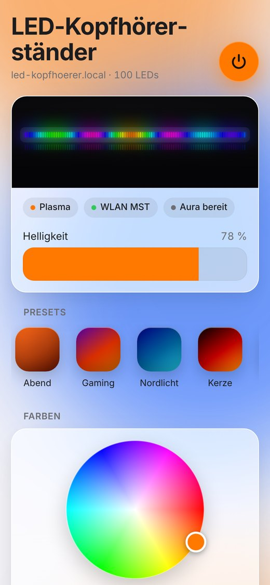
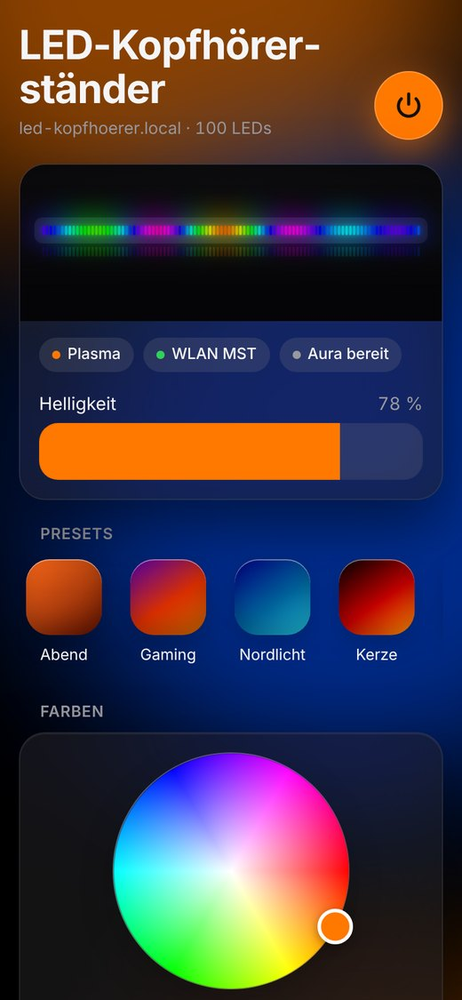

# ESP32-LED-Kopfhoererstaender

WLAN-Steuerung für die LED-Beleuchtung eines Kopfhörerständers. Ein Waveshare ESP32-C6-LCD-1.3 steuert einen WS2812B-Streifen (5 V, 144 LEDs, 1 m). Über eine Weboberfläche im Heimnetz wählst du Farben, Paletten und bewegte Effekte, ähnlich wie bei WLED. Das eingebaute Display zeigt IP-Adresse, Effekt, Helligkeit und eine LED-Vorschau.

<p align="center">
  
  
</p>

<p align="center">
  
</p>

Die Bilder zeigen die Weboberfläche mit Beispieldaten. Eine klickbare Vorschau ohne Gerät ist `web/index.html` mit `window.LED_DEMO = true`.

## Hardware

| Bauteil | Anschluss |
|---|---|
| ESP32-C6-LCD-1.3 | 5V-Pin über Schottky-Diode 1N5819, GND, **GPIO1 = LED-Daten**, **GPIO2 = ARGB-Eingang** |
| ARGB-Kabel vom Mainboard | D über 1 kΩ / 2 kΩ an GPIO2, G an GND, 5V frei |
| 74AHCT125 | Pegelwandler 3,3 V → 5 V (Kanal 1), 100 nF an Pin 14 |
| WS2812B | DIN über 330 Ω, +5 V/GND direkt vom Netzteil |
| Netzteil | USB-C-Netzteil 5 V / 3 A über USB-C-Buchse mit 5,1-kΩ-CC-Widerständen, Stromgrenze 2400 mA |

Schaltplan, Breadboard-Belegung und Bauteilliste: [`docs/hardware/schaltung.html`](docs/hardware/schaltung.html). Im Browser öffnen. Die Seite wird mit `python3 docs/hardware/gen_schaltung.py` aus der Vorlage neu erzeugt.

## Bauen und flashen

Voraussetzung: VS Code mit PlatformIO (wie im Testprojekt `ESP32-C6-LCD-1.3`).

1. Repo mit Fork klonen, z. B. nach `K:\Fork-GitHub\ESP32-LED-Kopfhoererstaender`.
2. Den Ordner in VS Code öffnen. PlatformIO lädt beim ersten Bauen die Plattform `pioarduino` (Arduino-Core 3.x für den ESP32-C6) und die Bibliotheken FastLED und GFX Library for Arduino.
3. Board per USB-C anschließen, **Upload** in der PlatformIO-Leiste klicken.
4. Serieller Monitor mit 115200 Baud zeigt Verbindung und IP-Adresse.

Das USB-C-Netzteil für die LEDs darf beim Flashen angeschlossen sein. Die Diode verhindert, dass es in den USB-Anschluss zurückspeist.

## Erste Einrichtung (WLAN)

Die WLAN-Zugangsdaten stehen nicht im Code.

1. Beim ersten Start öffnet der Controller das WLAN **`LED-Kopfhoerer-Setup`** (ohne Passwort). Das Display zeigt das an.
2. Mit dem Handy verbinden. Die Einrichtungsseite öffnet sich meist von selbst, sonst `http://192.168.4.1` aufrufen.
3. Heim-WLAN wählen, Passwort eingeben, **Speichern und verbinden**. Der Controller startet neu.
4. Danach erreichst du die Steuerung unter **http://led-kopfhoerer.local** oder der IP-Adresse auf dem Display.

Findet der Controller das gespeicherte WLAN nach dem Einschalten 20 Sekunden lang nicht, öffnet er zusätzlich wieder das Einrichtungs-WLAN.

## Bedienung

- **Weboberfläche:** Live-Vorschau des Streifens, Ein/Aus, Helligkeit, Presets, Farbrad für zwei Farben, Paletten, Effekte mit animierter Vorschau, Tempo, Intensität, Aura und PC-Sync, Stromgrenze, Anzeige drehen, WLAN neu einrichten. Hell- und Dunkelmodus folgen dem Gerät. Auf dem iPhone lässt sich die Seite über *Teilen → Zum Home-Bildschirm* wie eine App ablegen.
- **Presets:** Tippen lädt ein Preset, „Speichern“ legt die aktuelle Einstellung als neues an (bis zu 12). Gedrückt halten bzw. Rechtsklick löscht eins. Presets liegen im Flash des Controllers und gelten für alle Geräte im Heimnetz.
- **BOOT-Taster kurz drücken:** nächster Effekt.
- **BOOT-Taster 5 s halten:** WLAN-Daten löschen, Neustart ins Einrichtungs-WLAN.

Alle Einstellungen werden etwa 3 Sekunden nach der letzten Änderung gespeichert und nach einem Neustart wiederhergestellt.

### Effekte

| Effekt | Farben | Intensität bedeutet |
|---|---|---|
| Einfarbig | Farbe 1 | – |
| Regenbogen | – | Anzahl Regenbögen |
| Farbverlauf | Farbe 1 → 2 | Anzahl Wiederholungen |
| Palette | Palette | Dichte |
| Atmen | Farbe 1 | – |
| Farbwischer | Farbe 1 und 2 | – |
| Theater-Jagd | Palette | Abstand |
| Komet | Farbe 1 | Schweiflänge |
| Scanner | Farbe 1 und 2 | Schweiflänge |
| Funkeln | Palette | Häufigkeit |
| Konfetti | Palette | Menge |
| Feuer | Glut-Farben | Flammenhöhe |
| Jonglieren | Palette | Anzahl Punkte |
| Wellen | Palette | Wellengröße |
| Sinus | Farbe 1 und 2 | Frequenz |
| Farbwechsel | Palette | – |
| Nordlicht | eigene Grün-Violett-Töne | Kontrast |
| Plasma | Palette | Feinheit |
| Meteorregen | Palette | Anzahl Meteore |
| Regentropfen | Palette | Häufigkeit |
| Herzschlag | Farbe 1 | Ausbreitung |
| Kerze | Farbe 1 (warm wählen) | Flackern |
| Lichtwelle | Palette | Dichte |
| Ozean | eigene Blautöne | Schaum |

Tempo 0 hält bewegte Effekte an. Die Palette „Eigene Farben“ nutzt Farbe 1 und 2.

## ASUS Aura über das Mainboard-Kabel

Der Ständer kann direkt von Armoury Crate/Aura gesteuert werden, ohne Zusatzsoftware. Dafür liest der ESP das Signal eines ARGB-Headers auf dem Mainboard mit. Für Aura ist der Ständer dann ein ganz normaler ARGB-Streifen.

**Anschluss** (siehe `docs/hardware/schaltung.html`):
- Header-Pin **D** → R3 1 kΩ → **GPIO2**, von GPIO2 → R4 2 kΩ → GND. Der Spannungsteiler macht aus 5 V etwa 3,3 V.
- Header-Pin **G** → GND des Aufbaus.
- Header-Pin **5V** bleibt frei. Die LEDs bekommen ihren Strom weiter vom eigenen Netzteil.

**In Armoury Crate:** Im Aura-Bereich die LED-Anzahl für den ARGB-Anschluss einstellen oder erkennen lassen. Die Firmware erkennt die Anzahl, die das Mainboard sendet (bis 300), und streckt sie auf 144 LEDs. Erlaubt Aura 144 LEDs, entspricht jede Aura-LED genau einer LED am Ständer. Viele Boards begrenzen auf weniger, dann übernimmt eine Aura-LED mehrere Ständer-LEDs.

**Verhalten:** Sendet das Mainboard, zeigt der Ständer die Aura-Farben. Display und Weboberfläche zeigen dann „Aura (… LEDs)“. Kommt 2 Sekunden lang kein gültiges Signal, etwa weil der PC aus ist, laufen wieder die eigenen Effekte. Der Eingang ist ab Werk **aus**. Erst wenn das Kabel angeschlossen ist, in der Weboberfläche den Schalter **Mainboard-ARGB übernehmen** einschalten.

Stürzt der ESP ab, während der ARGB-Empfang läuft, bleibt der Eingang beim nächsten Start gesperrt. WLAN und eigene Effekte laufen dann normal weiter, und die Weboberfläche zeigt einen Hinweis. Nach einem Aus- und Einschalten wird es erneut versucht.

Vorrang: Mainboard-Kabel vor PC-Sync per WLAN vor eigenen Effekten.

## Home Assistant und WLED-App

Der Controller verhält sich nach außen wie ein WLED-Gerät. Deshalb funktionieren die **WLED-Integration von Home Assistant** und die **WLED-App** (iOS/Android) ohne Zusatzsoftware.

**Home Assistant:** Meist taucht der Ständer unter *Einstellungen → Geräte & Dienste* von selbst als „Entdeckt: WLED“ auf. Sonst *Integration hinzufügen → WLED* und `led-kopfhoerer.local` oder die IP-Adresse eintragen.

| In Home Assistant | Am Ständer |
|---|---|
| Licht ein/aus, Helligkeit, Farbe | Ein/Aus, Helligkeit, Farbe 1 |
| Effekt | alle 24 Effekte mit ihren Namen |
| Auswahl „Farbpalette“ | Palette |
| Zahlen „Geschwindigkeit“ und „Intensität“ | Tempo und Intensität |
| Auswahl „Preset“ | Presets aus der Weboberfläche |
| Schalter „Sync Receive“ | PC-Sync per WLAN |

Damit lassen sich Automationen bauen, z. B. „Ständer auf Kerze, wenn abends das Wohnzimmerlicht gedimmt wird“. Nicht nachgebildet sind mehrere Segmente, Playlists, Nachtlicht-Timer und Firmware-Updates über Home Assistant.

## PC-Sync mit SignalRGB oder OpenRGB

Der Controller nimmt Farben vom PC entgegen und leuchtet dann synchron mit Mainboard, Lüftern und Co. (z. B. ASUS ARGB). Sendet der PC nichts mehr, laufen nach 2,5 Sekunden wieder die eigenen Effekte. Der Schalter **PC-Sync** in der Weboberfläche schaltet den Empfang ab.

| Protokoll | Port | Typische Quelle |
|---|---|---|
| DDP | UDP 4048 | SignalRGB, xLights, Hyperion |
| E1.31 / sACN | UDP 5568, Universum 1 | OpenRGB, xLights, Jinx |
| WLED-UDP (DRGB, DNRGB, WARLS) | UDP 21324 | SignalRGB (WLED-Integration), LedFx |

Damit Sync-Programme den Controller als WLED-Gerät erkennen, meldet er sich per mDNS als `_wled._tcp` und beantwortet die WLED-Schnittstelle (siehe Home Assistant).

**SignalRGB:** Unter *Geräte* die WLED-Integration öffnen und den Controller hinzufügen. Wenn er nicht automatisch auftaucht, die IP-Adresse vom Display von Hand eintragen. Danach als Streifen mit 144 LEDs im Layout platzieren.

**OpenRGB:** Unter *Settings → E1.31 Devices* ein Gerät anlegen: IP-Adresse des Controllers, Universum 1, Startkanal 1, 144 LEDs, Typ „Linear“. Danach OpenRGB neu starten.

Die Helligkeit aus der Weboberfläche und die Stromgrenze gelten auch im PC-Sync. Für die vollen Farben vom PC stellst du die Helligkeit auf 100 %.

## Stromgrenze

Die Firmware begrenzt die Helligkeit so, dass der berechnete Strom die eingestellte Grenze nicht überschreitet. Startwert ist 2400 mA (`include/config.h`), passend zum USB-C-Netzteil 5 V / 3 A. Farbige Effekte laufen damit in voller Helligkeit, nur Vollweiß auf allen LEDs wird gedimmt. War schon ein anderer Wert gespeichert, stellst du ihn in der Weboberfläche auf 2400 mA. Mit einem stärkeren Netzteil (z. B. USB-C PD 12 V und Step-down auf 5 V / 6 A) kannst du auf etwa 85 % von dessen Strom erhöhen.

## Update über WLAN (optional)

OTA ist standardmäßig aus. Zum Einschalten `include/secrets.h` anlegen (wird nicht ins Repo übernommen):

```c
#define OTA_PASSWORD "dein-passwort"
```

Danach einmal per USB flashen. Ab dann geht es in `platformio.ini` mit:

```ini
upload_protocol = espota
upload_port = led-kopfhoerer.local
upload_flags = --auth=dein-passwort
```

## API

| Methode | Pfad | Zweck |
|---|---|---|
| GET | `/api/state` | aktueller Zustand als JSON |
| POST | `/api/state` | Felder `on`, `bri`, `fx`, `pal`, `spd`, `int`, `c1`, `c2` (`#rrggbb`), `ma`, `sync`, `argb`, `rot` (0–3) |
| GET | `/api/info` | Effekt- und Palettennamen, Netzwerkdaten |
| GET | `/api/live` | aktuelle LED-Farben als Hex-Text, 6 Zeichen je LED |
| GET/POST | `/api/presets` | Presets als JSON (POST-Feld `data`) |
| GET | `/json`, `/json/si`, `/json/info`, `/json/state`, `/json/eff`, `/json/pal`, `/presets.json` | WLED-kompatible Abfrage |
| POST | `/json/state` | WLED-kompatibel setzen: `on`, `bri`, `ps`, `udpn.recv`, `seg` mit `col`, `fx`, `sx`, `ix`, `pal` |

Beispiel: `curl -X POST -d "fx=11&bri=200" http://led-kopfhoerer.local/api/state`

## Aufbau des Codes

| Datei | Inhalt |
|---|---|
| `include/config.h` | Pins, LED-Anzahl, Stromgrenze, Hostname |
| `src/main.cpp` | Ablauf, Bildrate, Ein-/Ausblenden, BOOT-Taster |
| `src/effects.cpp` | alle Effekte und Paletten |
| `src/net.cpp` | WLAN, Einrichtungs-WLAN, Webserver, mDNS, OTA |
| `src/realtime.cpp` | PC-Sync: Empfang von DDP, E1.31 und WLED-UDP |
| `src/wled_api.cpp` | WLED-kompatible JSON-Schnittstelle für Home Assistant und WLED-App |
| `src/argb_in.cpp` | ARGB-Eingang: liest das Mainboard-Signal per RMT an GPIO2 mit |
| `web/index.html` | Weboberfläche (Quelle) |
| `src/webui_index.h` | daraus erzeugt mit `python tools/web2h.py`, nicht von Hand ändern |
| `src/webui.h` | Einrichtungsseite |
| `src/display.cpp` | Anzeige auf dem LCD |
| `src/settings.cpp` | Speichern der Einstellungen und WLAN-Daten im Flash |
