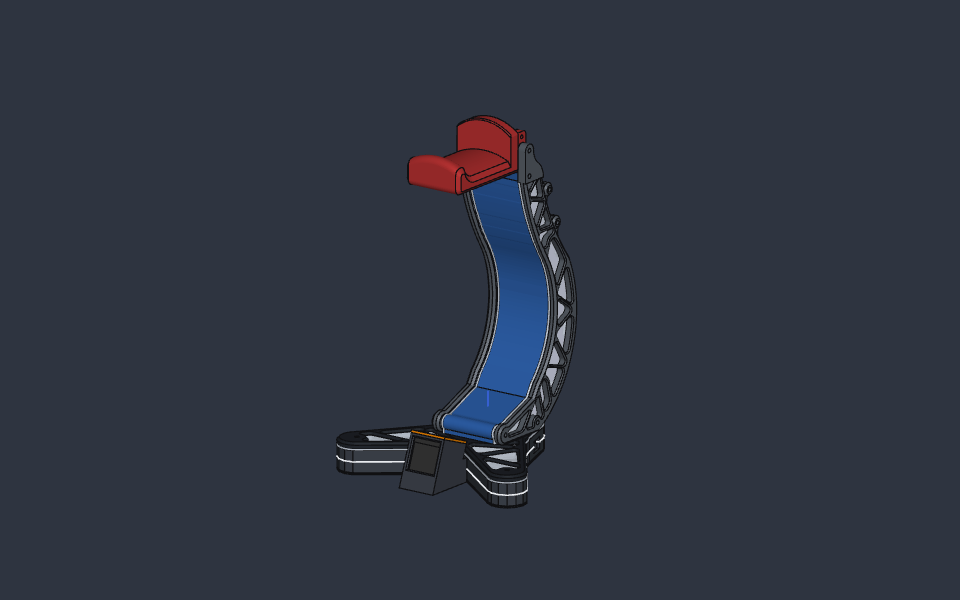
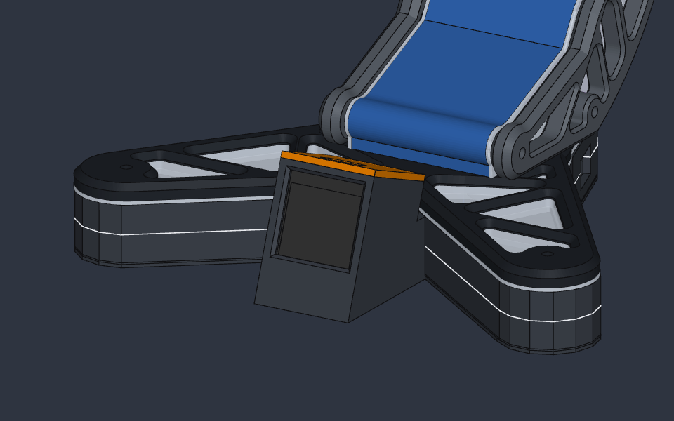
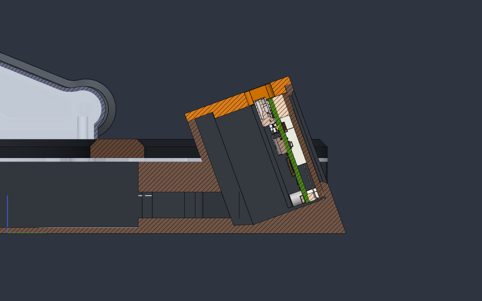

# Gehäuse für das ESP32-C6-LCD-1.3 im Kopfhörerständer

Angepasster Grundkörper (`Base_Box`) für den [RGB Headphone Stand von FaisLeFr](https://www.thingiverse.com/thing:4722406). Vorne in der V-Kerbe zwischen den beiden Armen sitzt ein eigenes Gehäuse für das Waveshare ESP32-C6-LCD-1.3. Das Display zeigt nach vorne, unter die Kopfhörerauflage, und ist 20° nach hinten geneigt.

  
  

## Aufbau

- **Board-Tasche:** Das Board wird von oben eingeschoben, das Display liegt vorne am Fenster an. Spiel seitlich ca. 0,45 mm.
- **Fenster:** 24,5 × 24,5 mm mit 1-mm-Fase, mittig über der aktiven Fläche (23,4 × 23,4 mm). Frontwand 1,8 mm.
- **Halteleisten:** Zwei Leisten (1,6 × 1,2 mm) an den Seitenwänden liegen 0,1 mm hinter den Spitzen der vier M2-Abstandsbolzen auf der Board-Rückseite. Sie halten das Board gegen das Fenster und lassen die Stiftleisten frei.
- **Kabelraum:** Hinter den Stiftleisten bleiben ca. 5,6 mm für gelötete Litzen (5V, GND, GPIO1, GPIO2). Für Dupont-Stecker reicht der Platz nicht.
- **Kabelweg:** Ein Trichter führt von der vollen Taschenbreite in den Kanal (8 × 7 mm) ins Innere des Grundkörpers. Die seitliche Öffnung des Original-Grundkörpers bleibt für die 5-V-Zuleitung.
- **Deckel:** Er wird oben aufgesteckt. Der Zapfen liegt nur über dem Board, die Öffnung für den USB-C-Stecker (12,5 × 7,5 mm, R1,5) sitzt direkt über der Buchse. Sie ist auf den Steckerkörper ausgelegt, weil die Buchse ca. 3 mm unter der Deckeloberkante liegt.
- **Vertiefung für die Diffuser_box:** Die drei Diffusorscheiben liegen in einer 0,5 mm tiefen Vertiefung im Boden (Spiel ca. 0,25 mm, Restboden 1,0 mm). Im Original-Grundkörper gibt es sie nicht, dort ragen die Scheiben 0,5 mm in den Boden.

  

## Dateien

| Ordner | Datei | Inhalt |
|---|---|---|
| `drucken/` | `Base_Box_ESP32.stl` | Grundkörper mit Displaygehäuse |
| `drucken/` | `ESP32_Lid.stl` | Deckel |
| `drucken/` | `RGB Headphone Stand - ESP32.3mf` | Beide Teile in einer Datei |
| `cad/` | `RGB Headphone Stand - ESP32.sc` | SolidCraft-Modell von Grundkörper und Deckel |
| `cad/` | `RGB Headphone Stand - Baugruppe.sc` / `.3mf` | Ganzer Ständer zusammengebaut, nur zur Ansicht |
| `bilder/` | `*.png` | Ansichten und Schnitte |

Die CAD-Dateien enthalten kein Board-Modell. Wer das Board zum Prüfen braucht, lädt die STEP-Datei von der [Waveshare-Seite zum ESP32-C6-LCD-1.3](https://docs.waveshare.com/ESP32-C6-LCD-1.3) (Resources) und fügt sie in SolidCraft ein.

## Drucken

- Alles ist ohne Stützmaterial druckbar.
- **Grundkörper:** Wie das Original mit dem Boden nach unten drucken. Das Displaygehäuse ist oben offen. Die Decke des Trichters ist eine Brücke von 27 mm zwischen festen Wänden.
- **Deckel:** In Bambu Studio mit „Auf Fläche legen" auf die Oberseite legen.
- **Material:** Kein metall- oder carbonhaltiges Filament verwenden. Die WLAN-Antenne des Boards sitzt unten im Gehäuse und wäre sonst abgeschirmt.

## Benötigte Originalteile

Alle anderen Teile stammen unverändert aus dem [RGB Headphone Stand (Thingiverse 4722406)](https://www.thingiverse.com/thing:4722406) von **FaisLeFr**, einem Remix des Designs von NoycePrints. Lizenz: **Creative Commons – Attribution (CC BY)**. `Base_Box_ESP32` ist eine Abwandlung der dortigen `Base_Box`.

Aus dem Original gebraucht werden: 1_Base, Diffuser_base, Diffuser_box, 2 × Sides (eine Seite gespiegelt), Side_Diffuser LEFT und RIGHT, Front_Cover, Back_Cover, Headpone_post / mount, Cable_hook sowie die M3-Schrauben laut Original-Anleitung. Die `Base_Box` des Originals wird durch `Base_Box_ESP32` ersetzt.

## Montage

1. Litzen an 5V, GND, GPIO1 und GPIO2 anlöten. Die Stiftleisten zeigen nach hinten in den Kabelraum.
2. Die Litzen durch den Trichter und den Kanal ins Innere des Grundkörpers führen. Nicht direkt über die Antenne legen (unteres Board-Ende, Rückseite), sondern seitlich vorbei.
3. Das Board mit dem Display nach vorne von oben einschieben, bis es unten aufliegt.
4. Den Deckel aufstecken. TF-Karte und die BOOT- und RESET-Taster sind nur bei abgenommenem Deckel und herausgezogenem Board erreichbar.

## Offene Punkte

- **Stiftleisten-Abstand prüfen:** Laut Waveshare-Zeichnung liegt die Lochreihe in der Flucht der M2-Bolzen, 1,93 mm vom Platinenrand. Liegt sie weiter außen, müssen die Halteleisten schmaler werden.
- **Probedruck steht aus.** Passung von Board, Deckel und Diffusorscheiben ist nur am Modell geprüft.
- **Überstand:** Die Front des Displaygehäuses steht ca. 4,6 mm über die Armspitzen hinaus.
- **Nachgebauter Grundkörper:** Der Grundkörper ist aus der Original-STL nachgebaut. Die Mulde für den alten Controller entfällt, die Wände sind leicht facettiert (ca. 0,05 mm).
