# Gehäuse für das ESP32-Board im Kopfhörerständer

Angepasster Grundkörper (`Base_Box`) für den [RGB Headphone Stand von FaisLeFr](https://www.thingiverse.com/thing:4722406). Vorne in der V-Kerbe zwischen den beiden Armen sitzt ein eigenes Gehäuse für das Board. Das Display zeigt nach vorne, unter die Kopfhörerauflage, und ist 20° nach hinten geneigt.

Aktuelles Board ist das **Waveshare ESP32-C6-Touch-LCD-1.9** (1,9", 170 × 320, Touch). Für das defekte ESP32-C6-LCD-1.3 liegt das alte Gehäuse im Archiv [`c6-lcd-1.3/`](#archiv-esp32-c6-lcd-13).

Für das C6-Touch-LCD-1.9 gibt es zwei Varianten, **hochkant** und **quer**. Welche es wird, entscheidet ein Probedruck.

<p align="center">
  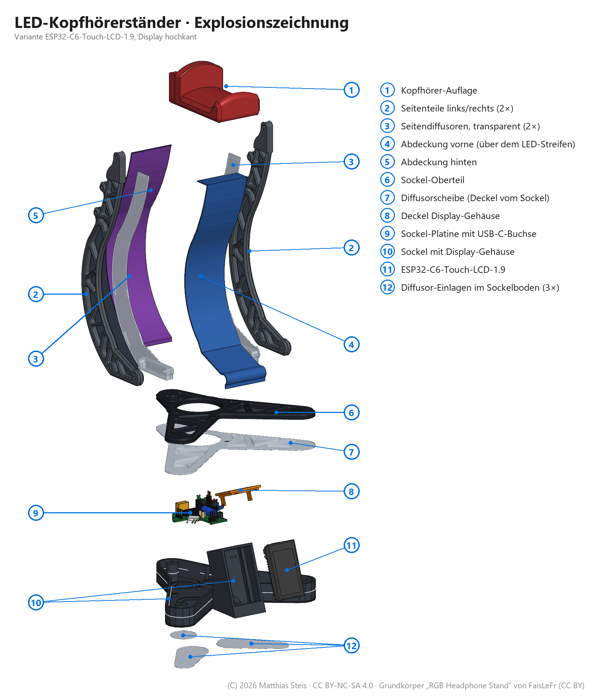
</p>

Explosionszeichnung des ganzen Ständers (Variante hochkant), die Legende steht im Bild.

| Hochkant | Quer |
|---|---|
| 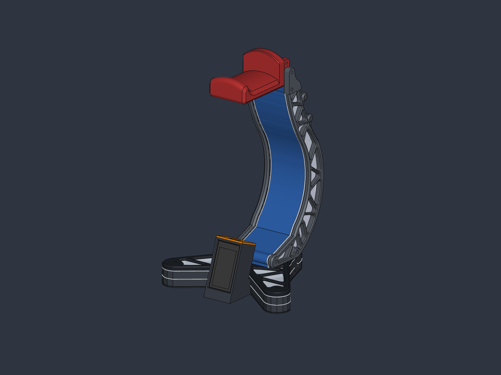 | 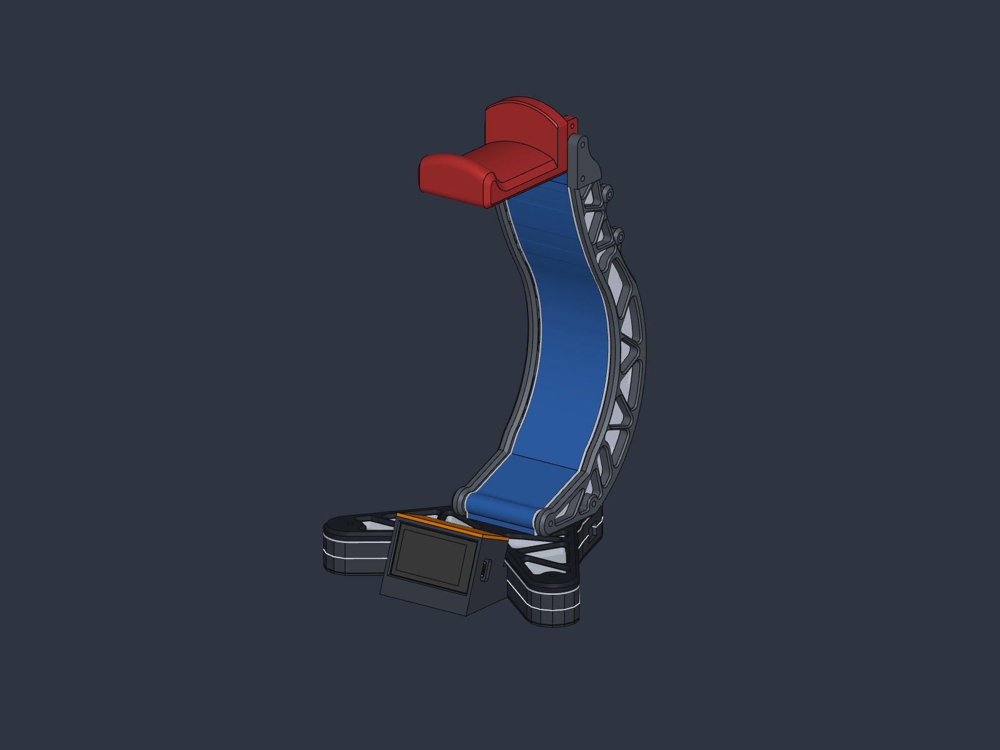 |
| 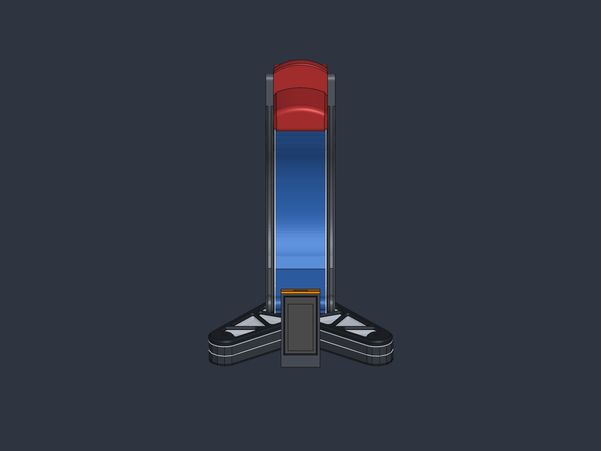 | 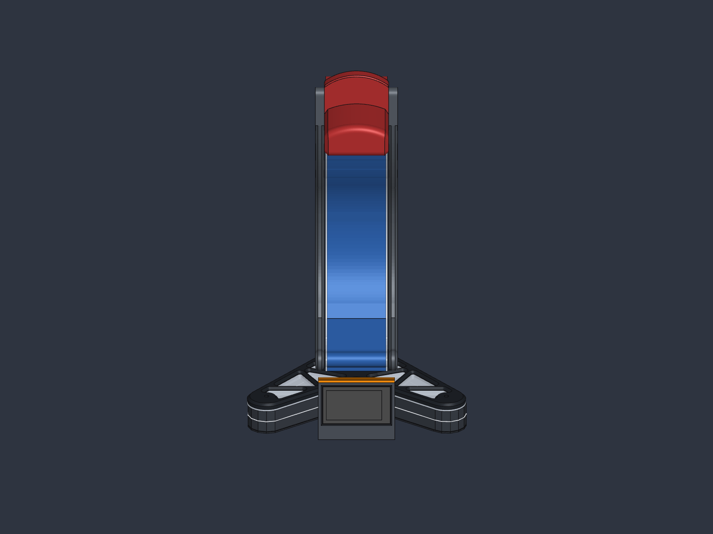 |

<p align="center">
  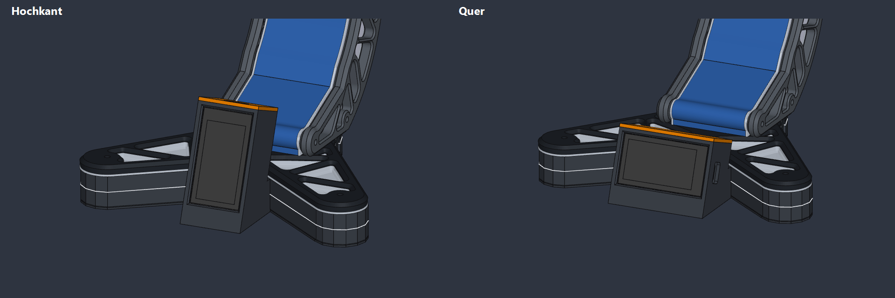
</p>

## Board-Daten

Waveshare liefert auf der [Seite zum ESP32-C6-LCD-1.9](https://docs.waveshare.com/ESP32-C6-LCD-1.9/Resources-And-Documents) ein STEP und eine Maßzeichnung, die beide „ESP32-S3-Touch-LCD-1.9“ heißen. Die Bauteile im STEP gehören zur S3-Variante, die Mechanik ist aber für C6 und S3 gleich. Für das Gehäuse zählt nur die Mechanik:

| Merkmal | Maß |
|---|---|
| Rahmen (Displaymodul) | 55,0 × 31,4 mm |
| Glas | 52,36 × 28,80 mm |
| Aktive Fläche | 43,12 × 23,10 mm, 1,95 mm von der USB-Seite weg versetzt |
| Platine | 52,6 × 29,0 × 1,2 mm |
| Bauhöhe | 7,8 mm bis Platinenrückseite, 11,8 mm bis zu den M2-Bolzen (4 mm), 17,35 mm bis zu den Pinspitzen |
| M2-Bolzen | 4 Stück, Abstand 40,75 × 25,0 mm |
| Stiftleisten | 2 × 20 Pins, Raster 2,54 mm, Reihenabstand 17,78 mm, eingelötet, Pins nach hinten |
| USB-C | mittig an einer kurzen Seite (31,4 mm), auf der Rückseite |

## Varianten

| | Hochkant | Quer |
|---|---|---|
| Ausrichtung | lange Seite nach oben | lange Seite waagrecht |
| Breite Gehäuse | 36,0 mm | 59,6 mm |
| Höhe über Tisch (mit Deckel) | 64 mm (66 mm) | 42 mm (44 mm) |
| Überstand über die Armspitzen | 2,3 mm | 11,3 mm |
| USB-C | oben durch den Deckel | seitlich durch die Seitenwand (von vorne gesehen rechts) |
| USB-Kabel | gerader Stecker | **90°-Winkelstecker nötig**, ein gerader Stecker stößt nach ca. 22 mm an den Arm |
| Halt des Boards | zwei Seitenleisten hinter den M2-Bolzen | Leiste unten hinter den Bolzen, zwei Finger am Deckel oben |
| Grundkörper | 59,7 cm³ | 71,1 cm³ |

**Hochkant:** schmal, sitzt sauber in der V-Kerbe, USB-Kabel oben und gerade, kaum Überstand. Dafür deutlich höher.

**Quer:** flach, wirkt wie eine Statusleiste. Dafür 11,3 mm Überstand, mehr Material, Winkelstecker nötig, USB-Kabel seitlich sichtbar. Ohne Überstand ginge es nur mit einer dreieckigen Aussparung in `1_Base` und `Diffuser_base` an beiden V-Kanten (bis ca. 9 mm tief, von x ±21 bis ±30 mm). Diese Lösung ist nicht modelliert.

<p align="center">
  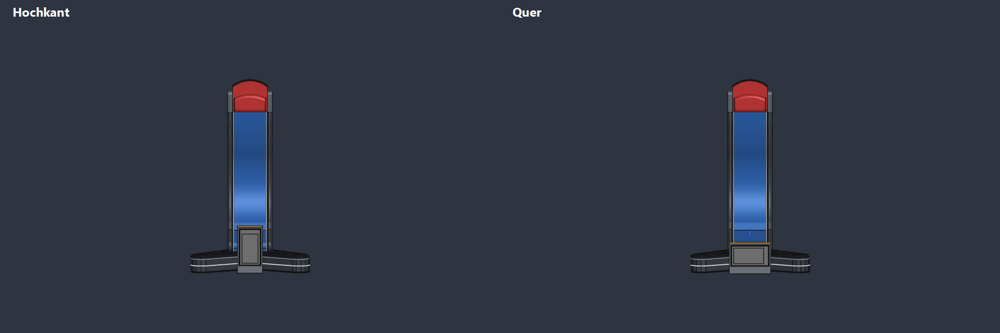
  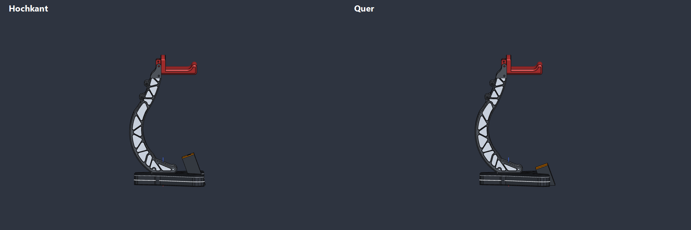
</p>

## Gemeinsame Merkmale

- **Einbau von oben:** Das Board wird von oben eingeschoben, der Deckel wird aufgesteckt.
- **Touch von vorne:** Die Frontlippe ist nur 1,2 mm dick, das Glas liegt 1,3 mm hinter der Gehäusefront. Vom Fensterrand bis zur aktiven Fläche sind es mindestens 3,2 mm, ein Finger erreicht die ganze Fläche. Fenster mit 0,8-mm-Fase.
- **Halteleisten:** Sie liegen 0,1 mm hinter den Spitzen der M2-Bolzen und halten das Board gegen das Fenster. Zu den Stiftleisten bleiben mindestens 0,5 mm.
- **Kabelraum:** 5,5 mm hinter den Pinspitzen für gelötete Litzen (5V, GND, GPIO1, GPIO2). Ein Trichter über die ganze Taschenbreite führt in den Kanal (8 × 7 mm) ins Innere des Grundkörpers.
- **USB-C-Öffnung:** 12,5 × 7,5 mm mit R1,5, ausgelegt auf den Steckerkörper.
- **Vertiefung für die Diffuser_box:** Die drei Diffusor-Einlagen liegen in einer 0,5 mm tiefen Vertiefung im Boden (Spiel ca. 0,25 mm, Restboden 1,0 mm).
- **Optionale Antennen-Durchführung:** Das Feature `Antenna_Feedthrough` setzt ein Loch mit 6 mm Durchmesser in die Rückwand über den Deckplatten, für eine externe U.FL-Antenne (beim Touch-Board per Lötbrücke umschaltbar). Es ist in beiden Varianten unterdrückt, die STL-Dateien haben das Loch also nicht. In SolidCraft lässt es sich einschalten, danach STL neu exportieren.

## Rastdeckel v2

Der Deckel wird von oben aufgesteckt und rastet ein. Kleben ist nicht nötig. Stand nach dem Probedruck, die Passung ist bestätigt.

- **Kragen:** 22,70 mm tief, quer 55,45 mm und hochkant 31,85 mm lang. Die Öffnung im Gehäuse ist 22,85 × 55,6 bzw. 22,85 × 32,0 mm, das Spiel liegt also bei ca. 0,075 mm pro Seite. Der Kragen läuft über die ganze Tiefe, der Deckel kann nicht nach hinten rutschen.
- **2 Rastzungen** an der Rückwand, je 1,2 × 6 × 9 mm (quer bei x ±15, hochkant bei x ±9). Die Rastnase greift 0,8 mm in eine Nut in der Rückwand (7 mm breit, 0,9 mm tief).
- **Hebelkerbe:** 8 × 0,8 mm an der hinteren Deckelkante. Zum Öffnen dort einen kleinen Schraubendreher ansetzen.
- **Drucken:** Deckel mit 100 % Infill drucken, die Oberseite liegt auf dem Bett, die Rastzungen zeigen nach oben. Die STL-Dateien in `drucken/` sind schon so ausgerichtet. Stützmaterial ist nicht nötig. Ist der Sitz zu stramm, im Slicer die XY-Kompensation für den Deckel auf −0,05 mm setzen.

| Hochkant | Quer |
|---|---|
| 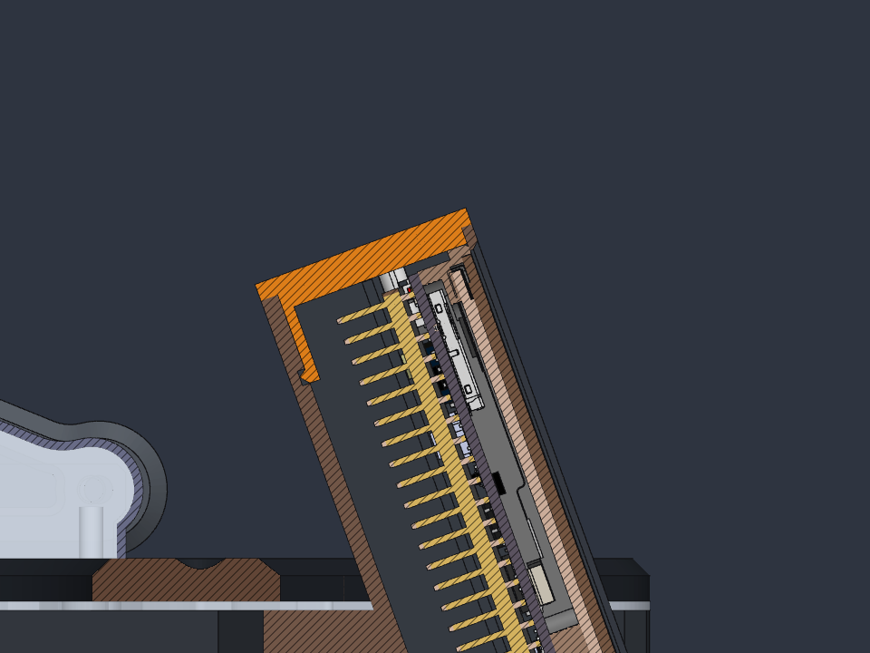 | 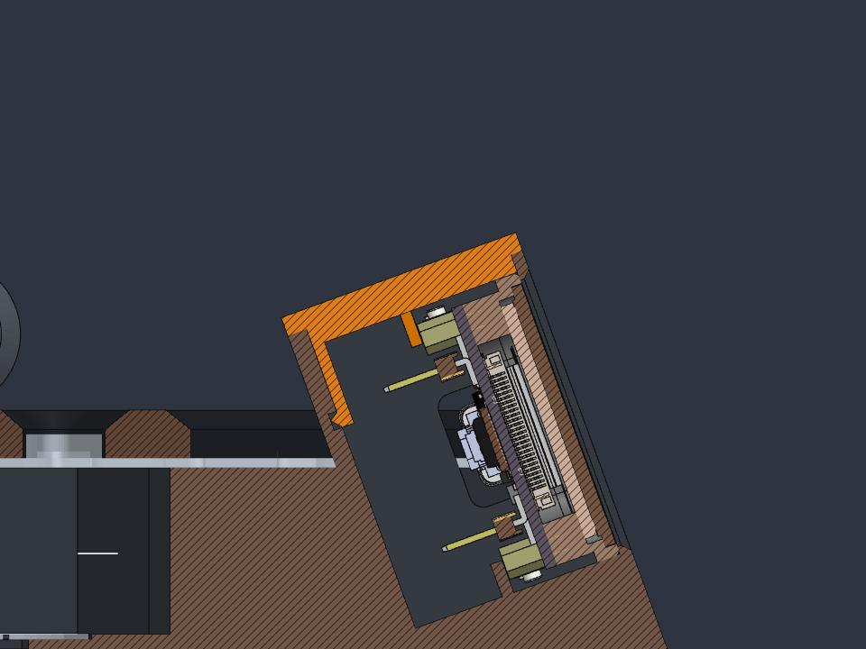 |
| 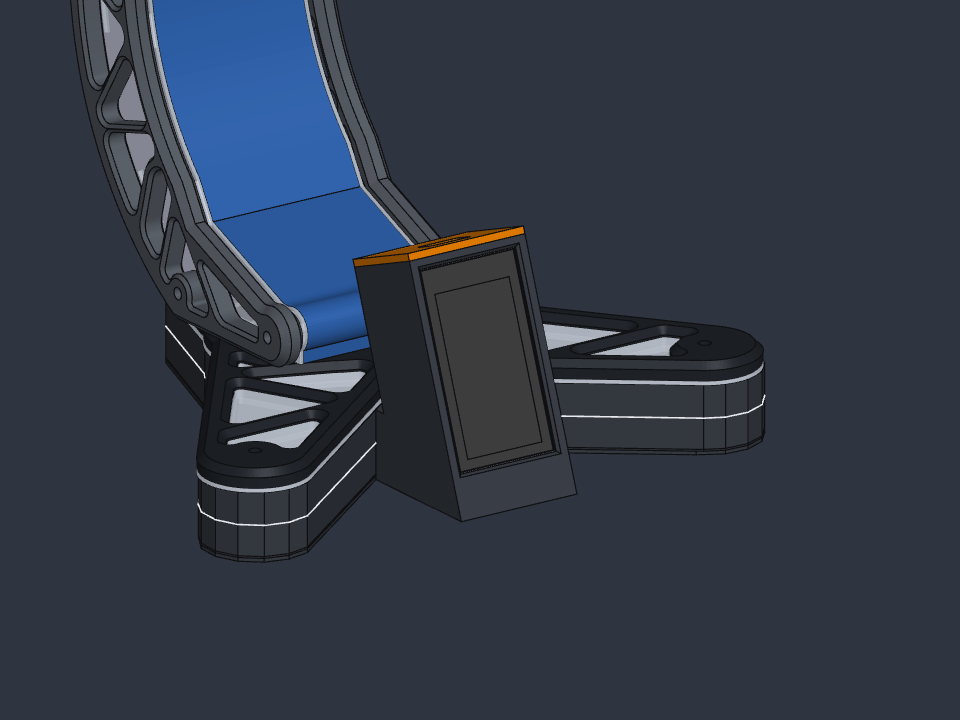 | 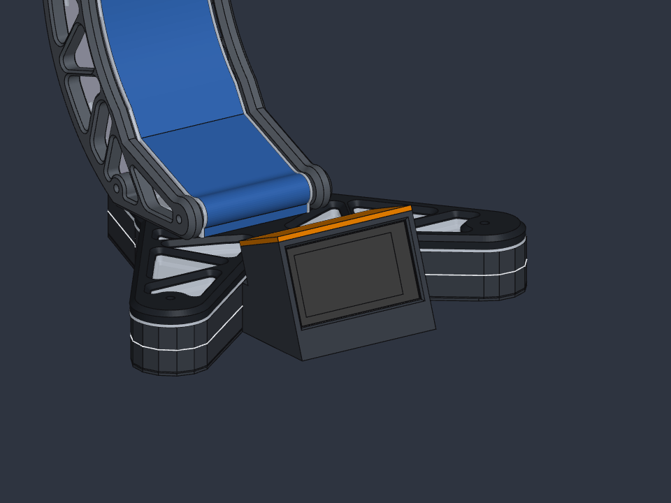 |

## Frontfixierung (7.11.2026)

Ersetzt die Rastzungen an der Rückwand aus Rastdeckel v2. Mit ihnen ließ sich der Deckel vorne leicht anheben. Der Kragen (22,70 mm, Spiel ca. 0,075 mm pro Seite) und die Hebelkerbe bleiben.

- **Einhängenase vorne:** 2 Nasen am Kragen vorne, je 5 mm breit (quer bei x ±20–25, hochkant bei x ±8–13), 0,5 mm vorstehend, mit 0,15-mm-Fase. Sie greifen in eine Tasche innen in der Frontwand über dem Display (5,4 × 0,85 mm, 0,55 mm tief).
- **Rastzungen an den Stirnwänden:** hinten in den Ecken, je 1,2 mm dick, 5 mm breit (2,5–7,5 mm vor der Rückwand), ca. 9 mm frei federnd, Rastnase 0,8 mm. Die passende Nut in der Stirnwand ist ca. 1 mm tief. Die alten Zungen hinten sind im Modell unterdrückt.
- **Montage:** Deckel vorne schräg mit den Nasen einhängen, dann hinten herunterdrücken, bis die Zungen einrasten. Beim Einschwenken federn die Zungen höchstens ca. 0,75 mm, die Frontnase streift 0,08 mm. Zum Öffnen hinten an der Hebelkerbe anheben und nach hinten herausschwenken.
- **Getestet:** Der Druck hochkant rastet hörbar ein und hat kein Spiel, auch vorne nicht. Quer ist gleich aufgebaut und rechnerisch geprüft (Kollisionen und Schwenkweg), aber noch nicht gedruckt.
- **Drucken:** Deckel mit 100 % Infill, Oberseite aufs Bett. Die STL in `drucken/` sind so ausgerichtet.

| Hochkant | Quer |
|---|---|
| 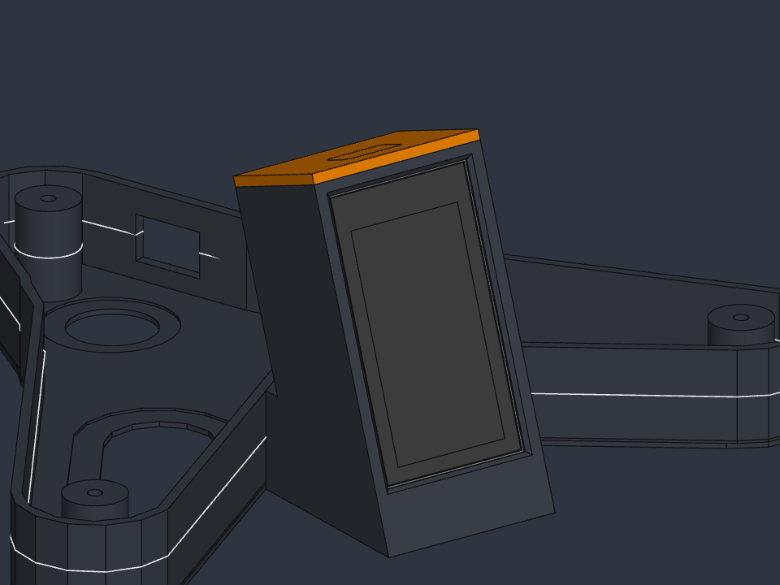 | 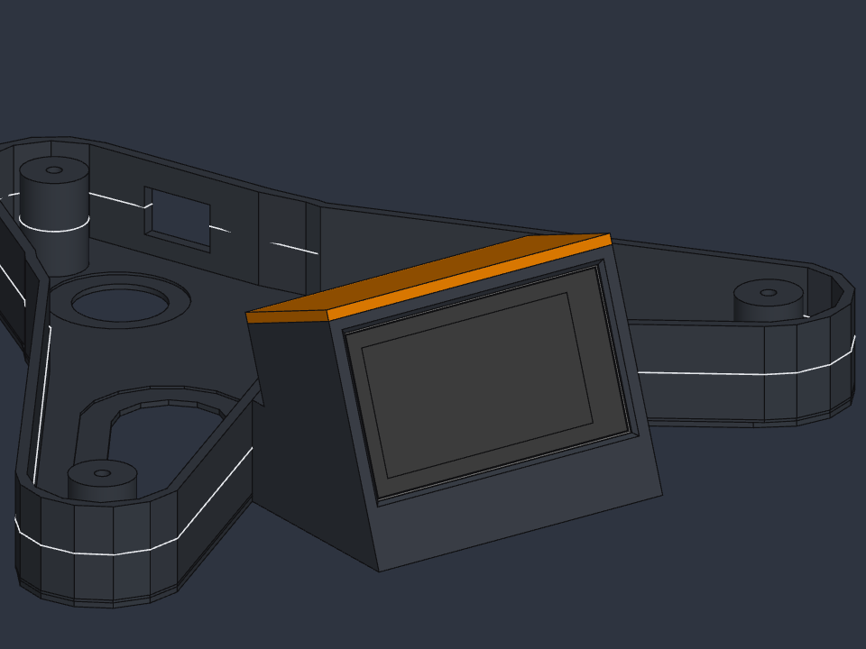 |
| 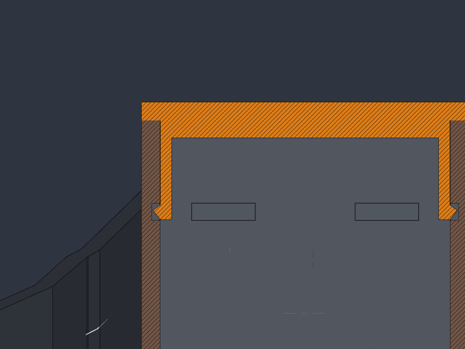 | 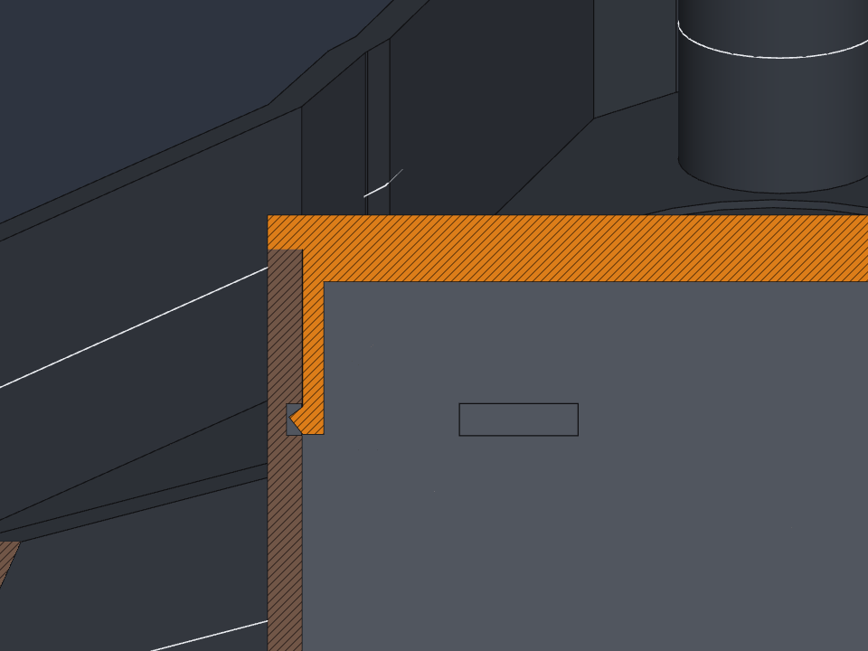 |
| 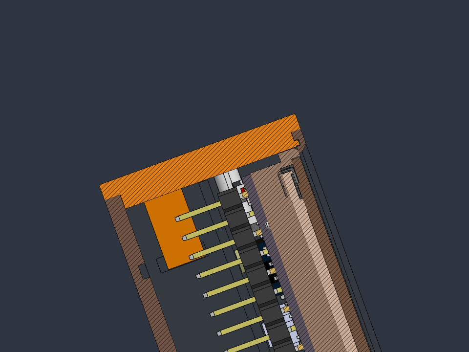 | 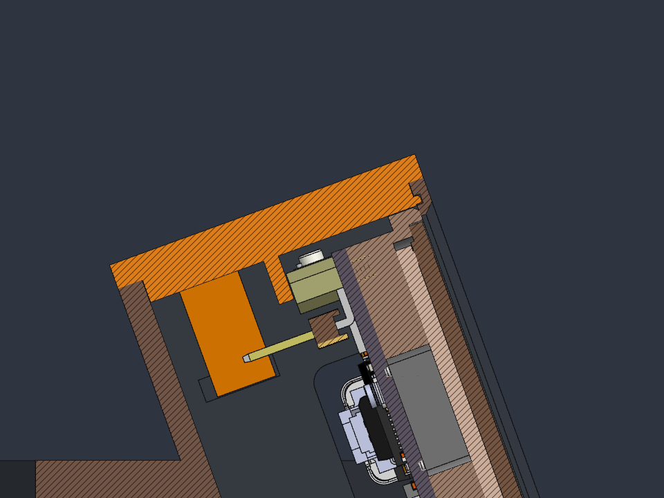 |

## Sockel mit Platine und USB-C (10.11.2026)

Im Sockel (`Base_Box_ESP32`) sitzen jetzt die Sockel-Platine (siehe [`../platine/`](../platine/)) und eine USB-C-Buchsenplatine (QUARKZMAN, 20 × 14 mm) für die Stromversorgung und optional PC-Sync über USB. Beide Varianten (hochkant und quer) haben denselben Sockelunterbau.

| Sockel hochkant mit Platine (Vorschau) | Baugruppe hochkant, Schnitt bei z 18,5 |
|---|---|
| 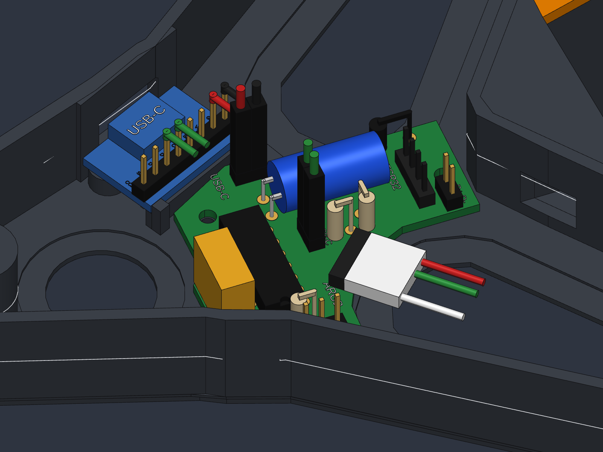 | 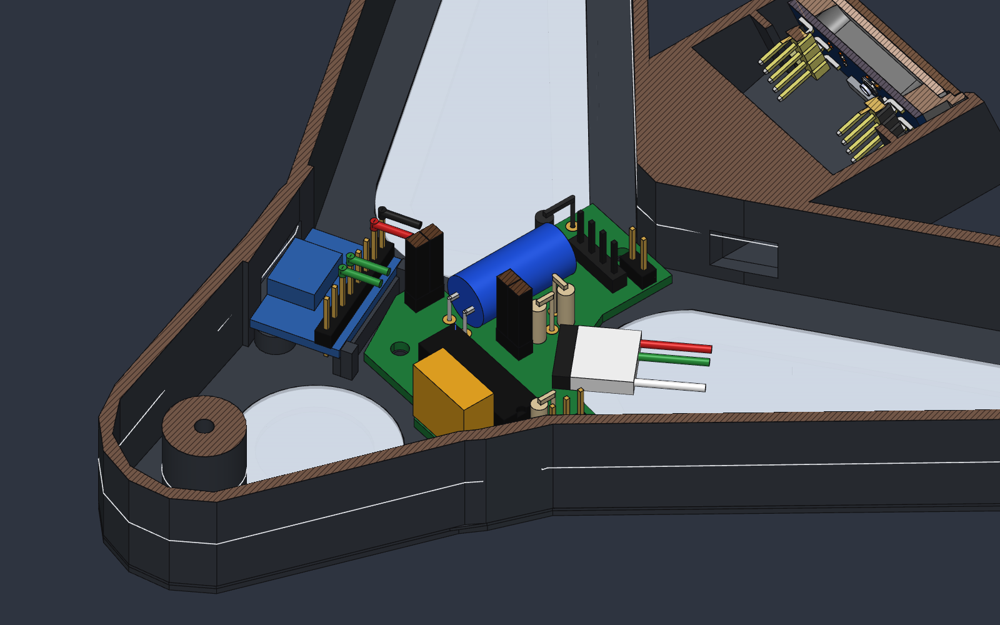 |
| 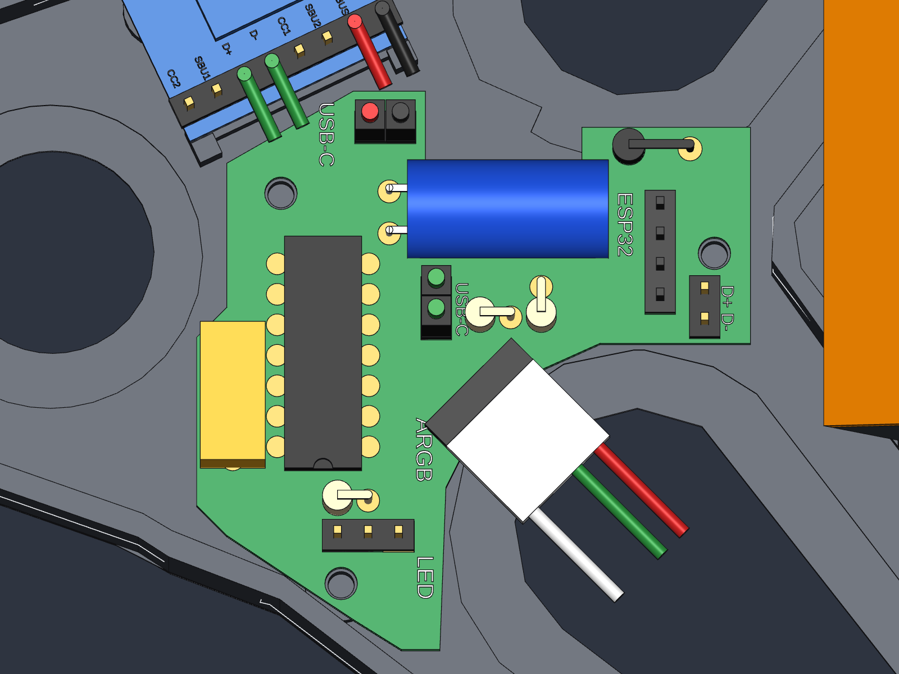 | 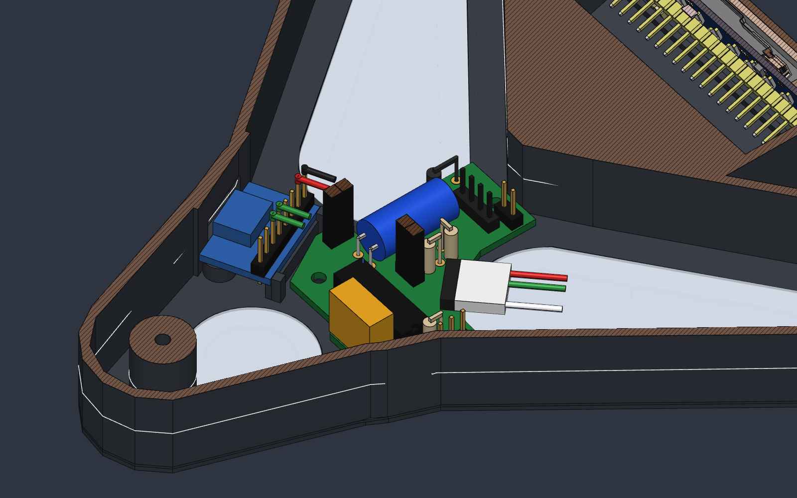 |

**Platinen-Dome:** drei Dome für M2,5-Schrauben bei (−5/−6), (27,5/−1) und (0/30) mm, Ø 6 mm, Oberkante 4 mm über dem Sockelboden, Kernloch Ø 2,2 × 3 mm (selbstschneidend). Die Platine liegt mit der Unterseite auf z 4.

**USB-C-Halter v2** (Probedruck passt):
- **Durchbruch** 13,0 × 7,2 mm mit 0,6-mm-Fase, mittig zur Buchse. Kleiner geht nicht: Die Umspritzung eines USB-C-Steckers (bis ca. 12,35 × 6,5 mm) muss ca. 2,5 mm in die Wand, die Buchse sitzt bündig an der Wandinnenseite.
- **Dome für die Buchsenplatine** (Oberkante z 5) und ein **Pad** an der Wand.
- **Stops** hinter der Buchsenplatine halten sie bei der Montage gegen Verrutschen. Sie sind um 0,75 mm gekürzt (Oberkante z 6,85) und stehen nur noch 0,25 mm über die Buchsenplatine.
- **Stützleiste** zwischen den Stops, 1,0 mm unter der Buchsenplatine. Die Lötaugen der 8er-Stiftleiste liegen 2,5 mm vor der Rückkante und bleiben frei.
- Die alte Kabelbohrung (`Power_Cable_Hole`) ist unterdrückt, Strom kommt über die USB-C-Buchse.

**Lehre aus v1:** Der erste Durchbruch begann genau an der Wandinnenfläche. Dadurch blieb in der STL eine Haut mit 0 mm Dicke stehen, die der Slicer zugedruckt hat. Durchbrüche deshalb ca. 0,2 mm innerhalb der Wand beginnen und außen überstehen lassen, danach die STL prüfen (z. B. Strahlentest durch die Öffnung).

**Anschlüsse:** Alle Anschlüsse der Platine sind 2,54-mm-Stiftleisten. Im Modell stecken an USB-Strom und USB-Daten gerade Dupont-Hülsen; darüber liegt die Diffusoröffnung mit Platz bis ca. 40 mm. Über LED-, ESP- und D+/D−-Leiste liegt die geschlossene Diffusorscheibe nur 13,4 mm über der Platine, ein gerader Dupont-Stecker (ca. 16,5 mm) passt dort nicht. LED und ESP werden deshalb angelötet (siehe Offene Punkte). An der Buchsenplatine sitzt die 8er-Stiftleiste (GND, VBUS, SBU2, CC1, D−, D+, SBU1, CC2), die Adern sind an Pin 1, 2, 5 und 6 angelötet.

**Elektronik im Modell:**
- Die Baugruppen (hochkant und quer) haben eine Gruppe **„Elektronik“** mit Platine, Bauteilen, Stiftleisten, Steckern und Buchsenplatine.
- `RGB Headphone Stand - ESP32.sc` (hochkant) hat eine Gruppe **„Elektronik (Vorschau)“** mit derselben Elektronik und der Beschriftung der Anschlüsse. Sie dient nur zur Ansicht.
- **Export:** Beim STL- oder 3MF-Export nur die Körper `Base_Box_ESP32` und `ESP32_Lid` exportieren oder die Elektronik-Gruppe vorher ausblenden, sonst landet die Elektronik im Druck. Der Hinweis steht auch in den Design-Eigenschaften der Datei.

## Dateien

```
c6-touch-1.9/
  hochkant/drucken/   Base_Box_ESP32.stl, ESP32_Lid.stl, RGB Headphone Stand - ESP32.3mf
  hochkant/cad/       SolidCraft-Modell (ESP32.sc) und Baugruppe (.sc/.3mf)
  hochkant/bilder/    Ansichten und Schnitte
  quer/drucken/       Base_Box_ESP32_quer.stl, ESP32_Lid_quer.stl, ESP32_quer.3mf
  quer/cad/           ESP32_quer.sc, Baugruppe_quer.sc/.3mf
  quer/bilder/        Ansichten
  vergleich/          beide Varianten nebeneinander (links hochkant, rechts quer)
c6-lcd-1.3/           Archiv des Gehäuses für das ESP32-C6-LCD-1.3
```

Die Baugruppen enthalten das Board-Modell (STEP von der Waveshare-Seite, siehe oben) und die Gruppe „Elektronik“. Sie sind nur zur Ansicht gedacht. Druckteile sind ausschließlich `Base_Box_ESP32` und `ESP32_Lid` bzw. die STL-Dateien in `drucken/`.

## Drucken

- Alles ist ohne Stützmaterial druckbar.
- **Grundkörper:** wie das Original mit dem Boden nach unten. Das Displaygehäuse ist oben offen. Die Fensteroberkante und die Decke des Trichters sind Brücken zwischen festen Wänden (bis 55 mm bei quer).
- **Deckel:** Die STL liegt schon druckfertig auf der Oberseite, mit 100 % Infill drucken (siehe [Rastdeckel v2](#rastdeckel-v2)).
- **Material:** Kein metall- oder carbonhaltiges Filament verwenden, sonst wird die WLAN-Antenne abgeschirmt.

## Montage

1. Am ESP32-C6-Touch-LCD-1.9 Litzen an VBUS (J4 Pin 1), GND (J4 Pin 3), GPIO3 (J3 Pin 7) und GPIO23 (J4 Pin 9) anlöten. Für PC-Sync über die Sockel-Buchse zusätzlich GPIO12/D− (J3 Pin 11) und GPIO13/D+ (J3 Pin 12).
2. Die Litzen durch den Trichter und den Kanal ins Innere des Grundkörpers führen und an die ESP-Stiftleisten der Sockel-Platine anschließen. Nicht direkt über den Antennenbereich des Boards legen.
3. Sockel-Platine mit drei Schrauben M2,5 auf die Dome schrauben. Die USB-C-Buchsenplatine zwischen Wand und Stops einlegen und auf ihre Dome schrauben. Strom (GND/VBUS) und bei Bedarf Daten (D−/D+) von der 8er-Leiste der Buchsenplatine zu den USB-Stiftleisten der Platine führen.
4. Das Board mit dem Display nach vorne von oben einschieben, bis es unten aufliegt. Die M2-Bolzen gleiten dabei vor den Halteleisten vorbei.
5. Den Deckel vorne einhängen und hinten herunterdrücken, bis die Rastzungen an den Stirnwänden hörbar einrasten (siehe [Frontfixierung](#frontfixierung-7112026)). TF-Karte und die BOOT- und RESET-Taster sind nur bei abgenommenem Deckel und herausgezogenem Board erreichbar.

## Benötigte Originalteile und Lizenz

Alle anderen Teile stammen unverändert aus dem [RGB Headphone Stand (Thingiverse 4722406)](https://www.thingiverse.com/thing:4722406) von **FaisLeFr**, einem Remix des Designs von NoycePrints. Lizenz: **Creative Commons – Attribution (CC BY)**. `Base_Box_ESP32` ist eine Abwandlung der dortigen `Base_Box`.

Aus dem Original gebraucht werden: 1_Base, Diffuser_base, Diffuser_box, 2 × Sides (eine Seite gespiegelt), Side_Diffuser LEFT und RIGHT, Front_Cover, Back_Cover, Headpone_post / mount, Cable_hook sowie die M3-Schrauben laut Original-Anleitung. Die `Base_Box` des Originals wird durch `Base_Box_ESP32` ersetzt.

## Offene Punkte

- **Antennenlage am echten Board prüfen.** Die C6-Platine ist anders bestückt als das S3-STEP. Wo die Keramikantenne sitzt, ist noch unbekannt.
- **Probedruck beider Varianten** (Passung von Board, Deckel und USB-Stecker). Der Rastdeckel v2 sitzt im Probedruck gut.
- **Probedruck quer** mit der Frontfixierung steht noch aus. Hochkant ist getestet.
- **Entscheidung hochkant oder quer** nach dem Probedruck.
- **Steckverbinder an LED, ESP und D+/D− (entschieden 10.11.2026):** Über diesen Leisten liegt die Diffusorscheibe nur 13,4 mm über der Platine, gerade Dupont-Stecker passen dort nicht. Deshalb: LED über ein angelötetes Kabel mit JST-SM-Gegenstück (Pigtail), ESP und ESP-D+/D− auf der Platine angelötet, am ESP-Ende Dupont. Gesteckt sind nur die beiden USB-Leisten unter der Diffusoröffnung. Siehe [Platinen-README](../platine/README.md).
- **Stops:** Um 0,75 mm gekürzt. Sie stehen noch 0,25 mm über die Buchsenplatine, fixieren sie bei der Montage und sind so gewollt.
- Der Grundkörper ist aus der Original-STL nachgebaut. Die Mulde für den alten Controller entfällt, die Wände sind leicht facettiert (ca. 0,05 mm).

## Archiv: ESP32-C6-LCD-1.3

Das erste Gehäuse war für das Waveshare ESP32-C6-LCD-1.3 (1,3", 240 × 240) gebaut. Das Board ist defekt, das Display ist gebrochen. Die Dateien liegen unverändert in [`c6-lcd-1.3/`](c6-lcd-1.3/): Hochkant-Einbau mit Fenster 24,5 × 24,5 mm, Halteleisten an den M2-Bolzen, Kabelraum und Deckel mit USB-C-Öffnung.
