# Ständer v2: Aufbau- und Zusammenbauanleitung

Stand v10 (22.11.2026). Eigene Neukonstruktion (CC BY-NC-SA 4.0, © 2026 Matthias Steis), ohne Teile aus dem Thingiverse-Original.

> **Hinweis:** Der Ständer ist noch nicht komplett probegedruckt. Maße wie die Schraublöcher der USB-C-Platine sind teils Annahmen und müssen beim ersten Aufbau nachgemessen werden. Aktuelle Druckdateien: [`stl/`](stl/README.md).

Weitere Unterlagen:

- **[Maßzeichnung (Blueprint)](blueprint.html)**: Ansichten von vorne, seitlich, oben und unten mit Maßen. Im Browser öffnen.
- [Schaltplan und Bauteile](../../schaltung.html), [Platine v2](../../platine-v2/)

## 1. Überblick

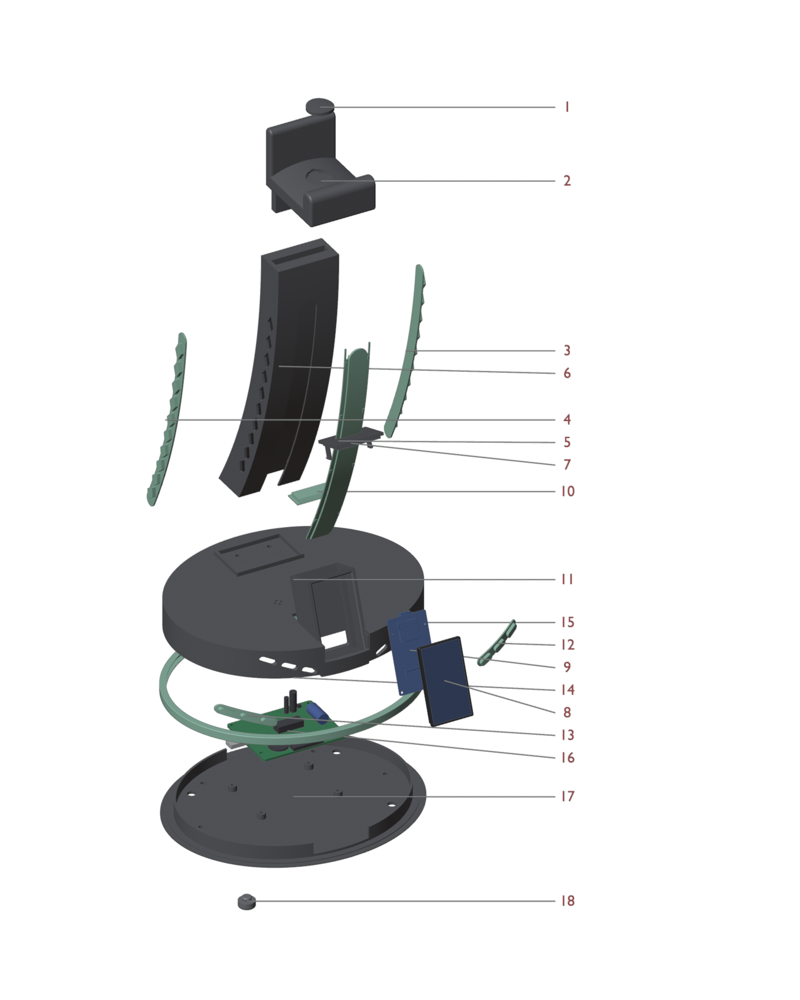

| Nr | Teil | Datei bzw. Herkunft |
|---|---|---|
| 1 | Druckplatte FSR | `Druckplatte_FSR.stl` |
| 2 | Kopfhörer-Auflage v4 | `Auflage_v4.stl` |
| 3 | Seiten-Inlay links (Rauten) | `Inlay_Seite_B_links.stl` |
| 4 | Seiten-Inlay rechts (Rauten) | `Inlay_Seite_B_rechts.stl` |
| 5 | Säulen-Streifen vorne | `Inlay_Saeule_v3.stl` |
| 6 | Säule B (Rauten) | `Saeule_v2_B_Rauten.stl` |
| 7 | Deckel Display-Gehäuse (hochkant) | `ESP32_Lid_Mikro_hochkant.stl` |
| 8 | Display ESP32-C6-Touch-LCD-1.9 (Display mit ESP) | Kaufteil Waveshare |
| 9 | ESP32-C6-Board | steckt im Displaymodul (Nr. 8) |
| 10 | Inlay Lichtschlitz hinter dem Display-Turm | `Inlay_Turm_hinten.stl` |
| 11 | Sockel-Schale v9 | `Sockel_oval_v9.stl` |
| 12 / 13 | Augen-Inlay links / rechts | `Inlay_Augen_links_v3.stl`, `Inlay_Augen_rechts_v3.stl` |
| 14 | Leuchtring | `Inlay_Leuchtring_v3.stl` |
| 15 | USB-C-Platine 20 × 14 | Kaufteil |
| 16 | Platine v2 (64 × 52) | [`platine-v2/`](../../platine-v2/), mit INMP441 und ARGB-Stecker |
| 17 | Bodenplatte | `Boden_v5.stl` |
| 18 | TPU-Fuß (4×) | `TPU_Fuss_4x.stl` |

Der Sockel allein, auseinandergezogen:

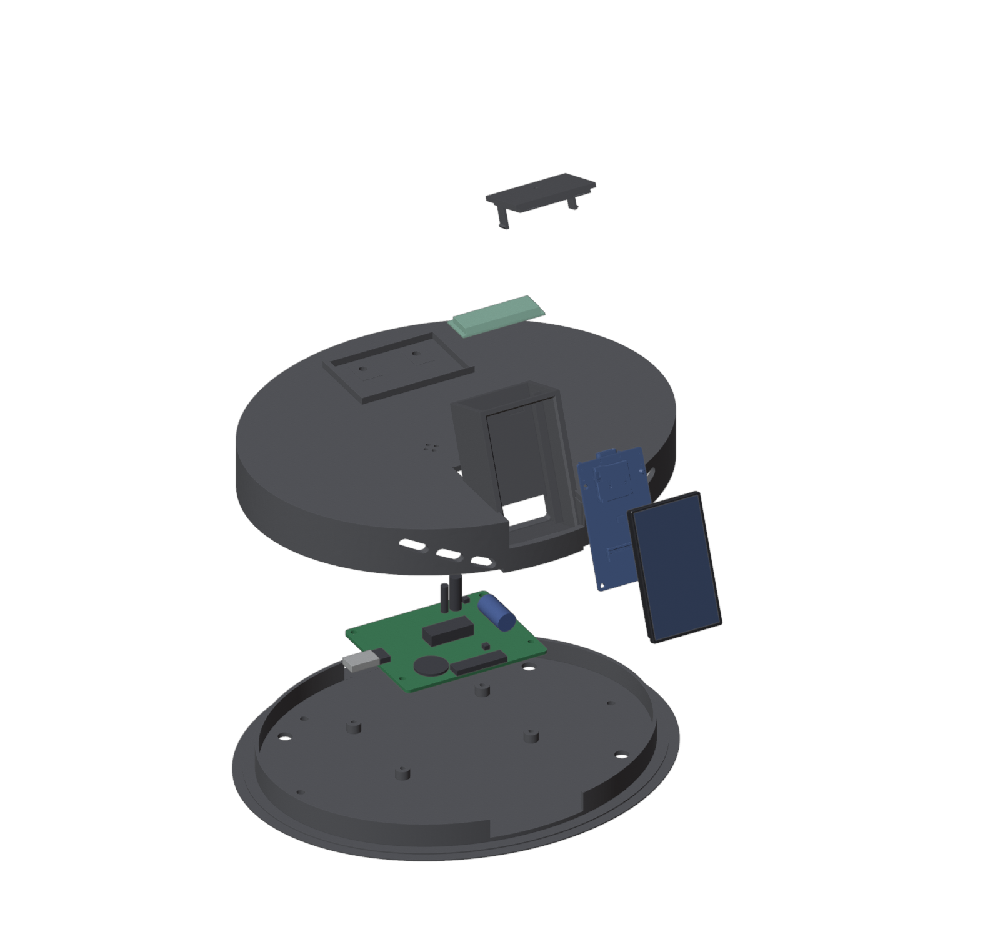

## 2. Was du außer den Druckteilen brauchst

| Menge | Teil | Wofür |
|---|---|---|
| 4 | Schraube M3 × 10 + 4 Einschmelzmuttern M3 | Boden an Schale |
| 4 | Schraube M2,5 × 6, selbstschneidend | Platine v2 an die Dome im Boden |
| 2 | Schraube M3 × 8 + 2 Einschmelzmuttern M3 | Säule an Sockeldeck (von innen) |
| 2 | Schraube M3 × 12 | Zapfen der Auflage in der Säule (von hinten) |
| 1 | FSR402-LT, Ø 18,25 mm | Kopfhörer-Sensor in der Auflage |
| 1 | INMP441 (Stiftleiste nach unten) | Mikrofon auf der Platine v2 |
| 1 | Moosgummi-Ring Ø 10/7 × 1,5 | Schalldichtung am Mikrofon |
| 1 | WS2812B-Streifen | auf die LED-Rippe, LEDs nach außen |
| 1 | 10er-Dupont-Kabel | Platine zu ESP |
| 1 | FSR-Verlängerung, ca. 30 cm | FSR zu J5 auf der Platine |

Teile bestellst du selbst. Preise und Bezugsquellen stehen bewusst nicht hier.

## 3. Druckeinstellungen

- Tragende Teile (Schale, Säule, Boden, Auflage, Druckplatte): PLA, 0,2 mm, 3 Wände, 20 % Füllung.
- Inlays (Diffusoren): Fluor-PLA, 100 % konzentrisch gefüllt. Nie für tragende Teile.
- TPU-Füße: TPU, 100 % Füllung.
- Lage und Stützen pro Teil: [`stl/README.md`](stl/README.md). Die Auflage liegt auf dem Rücken, ohne Stützen. Die Druckplatte liegt flach, Nasen nach oben.

## 4. Zusammenbau (Vorbereitung plus 8 Schritte)

Die Reihenfolge ist wichtig: **Die Säule wird verschraubt, solange der Boden noch offen ist**, weil die Schrauben von innen kommen.

### Schritt 0: Einschmelzmuttern setzen
Je 4 Muttern M3 in den Sockel für den Boden und 2 Muttern für den Säulenfuß mit dem Lötkolben einschmelzen. Gerade ansetzen, nicht kippen.

### Schritt 1: Boden und Platine
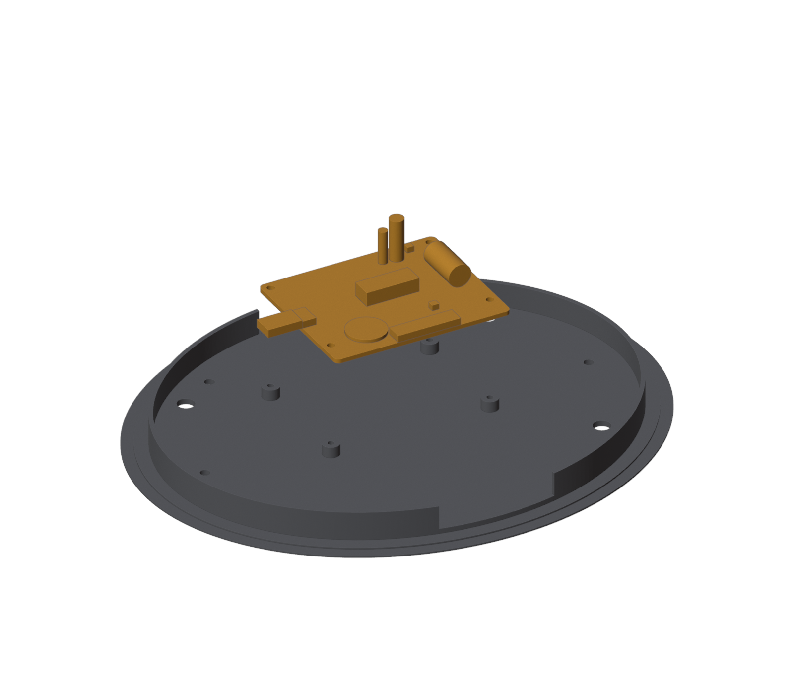

Platine v2 mit 4 × M2,5 × 6 auf die vier Dome im Boden schrauben. Das Mikrofon INMP441 kommt auf die Platine (Schallloch nach oben), der Moosgummi-Ring wird auf das Mikrofon gelegt. Der Kragen der Schale greift in Schritt 6 in den Ring. Der LED-Streifen klebt selbst auf der LED-Rippe, LEDs nach außen.

### Schritt 2: ESP/Display und USB-C
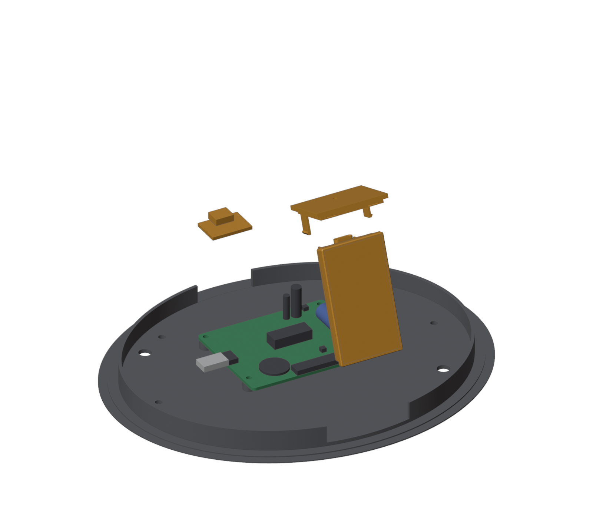

Display mit ESP in den Turm setzen, den Deckel hochkant einrasten. Die USB-C-Platine von unten bis zu den Rastarmen schieben, bis sie klickt (die Lochmaße der USB-C-Platine sind eine Annahme, nachmessen).

### Schritt 3: Sockel-Inlays
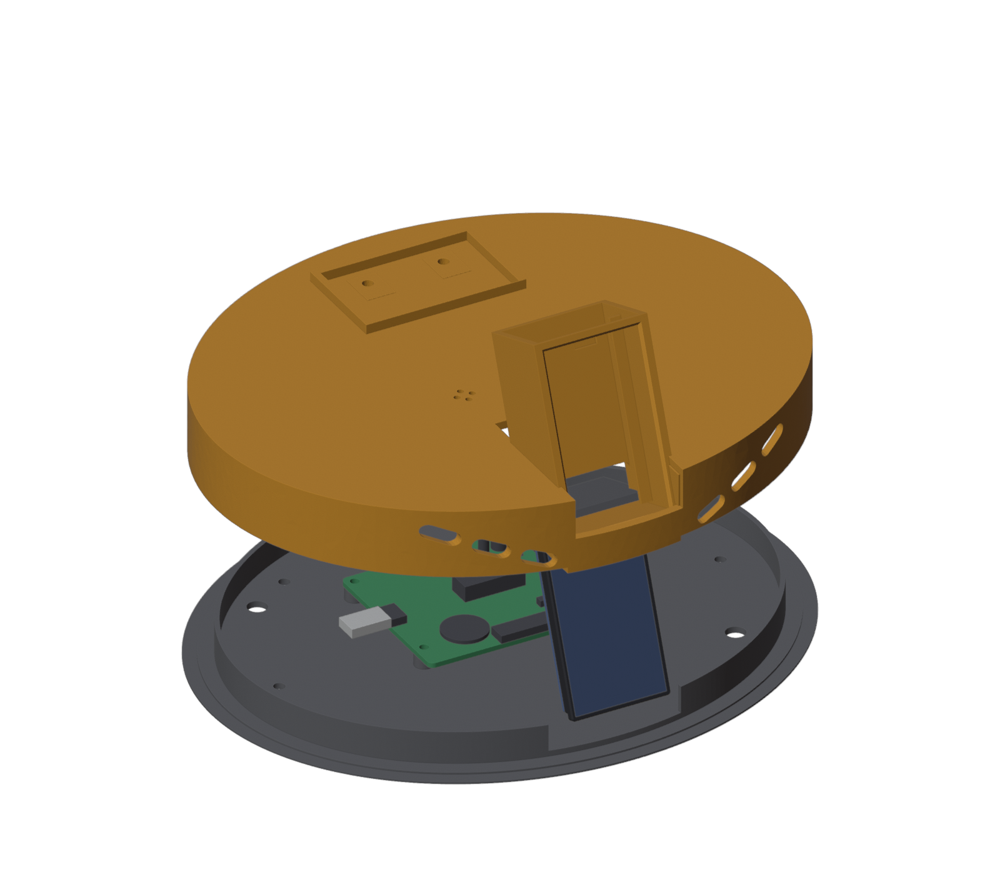

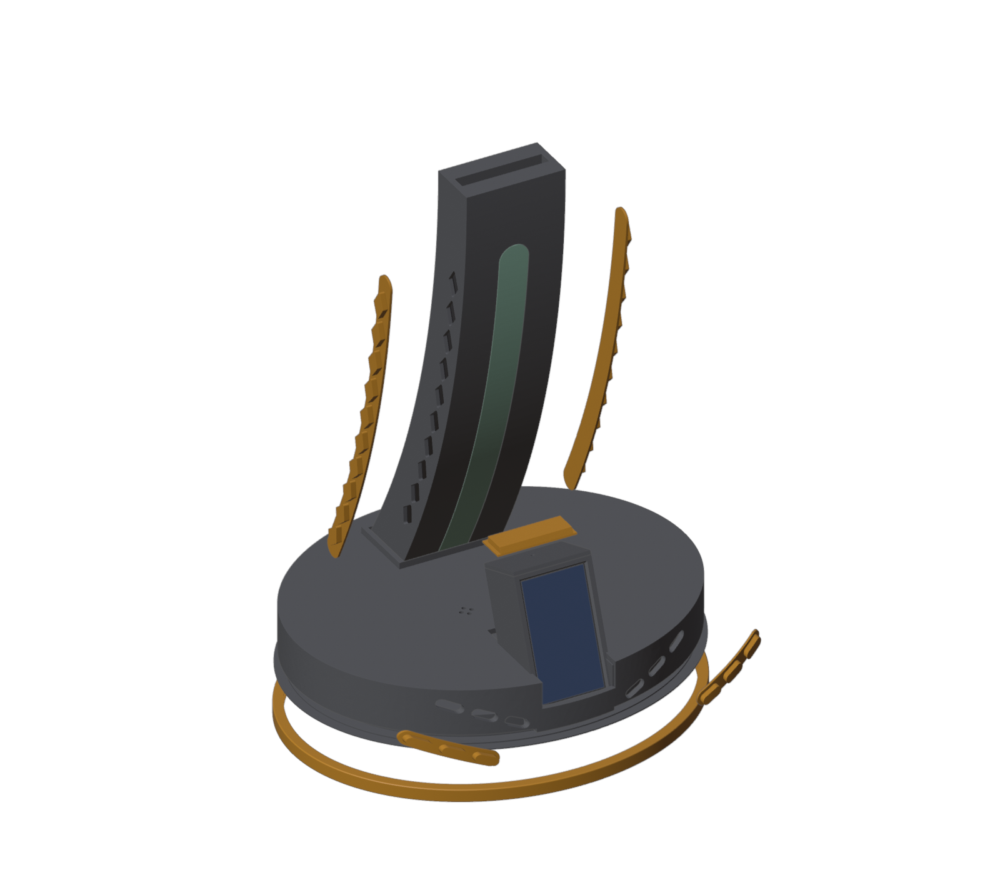

Augen-Inlays von innen einsetzen, ebenso das Turm-Inlay (hinten) und den Leuchtring. Die Inlays klemmen und werden nicht geklebt.

### Schritt 4: Säule
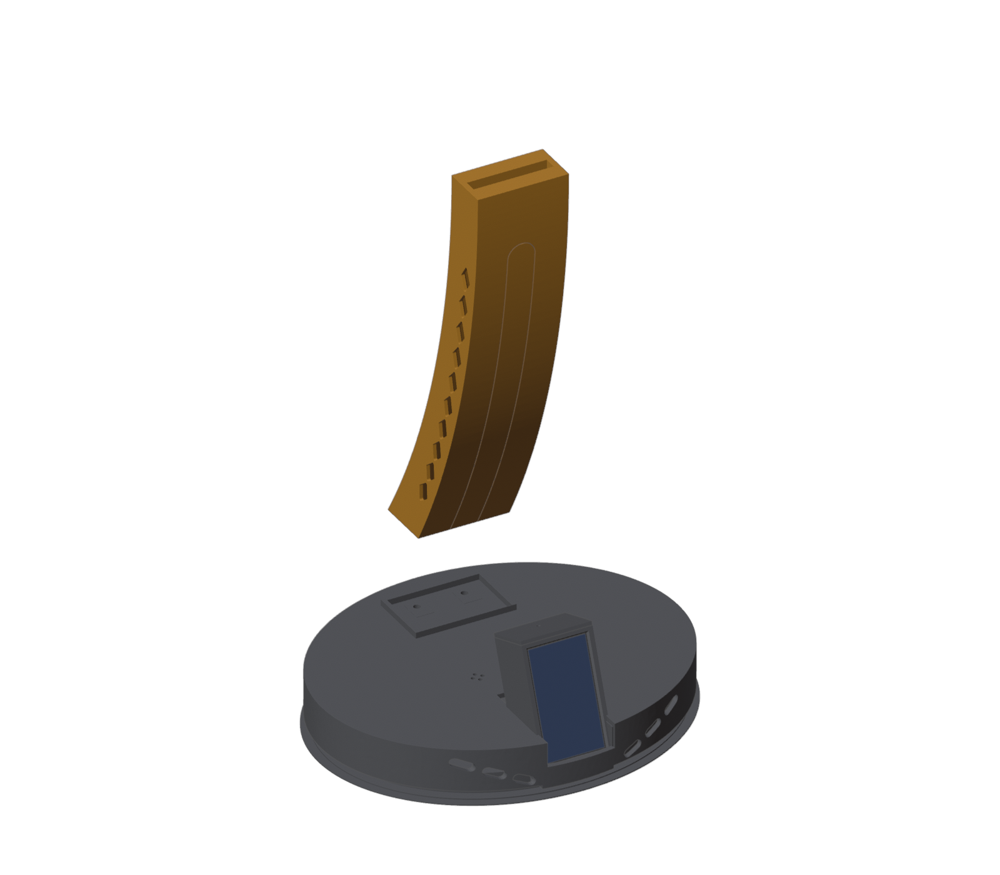

Front-Streifen von unten in die Nut schieben (8 Klemmnoppen). Seiten-Inlays von innen einsetzen. Säule mit 2 × M3 × 8 **von innen** durch das Sockeldeck am Säulenfuß verschrauben.

### Schritt 5: Verkabeln
10er-Dupont durch den Turm-Durchgang (32 × 10 mm) zum ESP. Das ARGB-Kabel geht durch den Schlitz 9 × 4,5 mm hinten rechts. Die FSR-Verlängerung (ca. 30 cm) wird jetzt an J5 auf der Platine gesteckt und durch die Säule nach oben geführt. Danach ist J5 nicht mehr erreichbar, also vorher testen. Verdrahtung: [Schaltplan](../../schaltung.html).

### Schritt 6: Schale auf den Boden
Schale auf den Boden setzen und mit 4 × M3 × 10 verschrauben. Kabel dabei nicht einklemmen, der Mikrofon-Kragen muss in den Moosgummi-Ring greifen.

### Schritt 7: Auflage und FSR
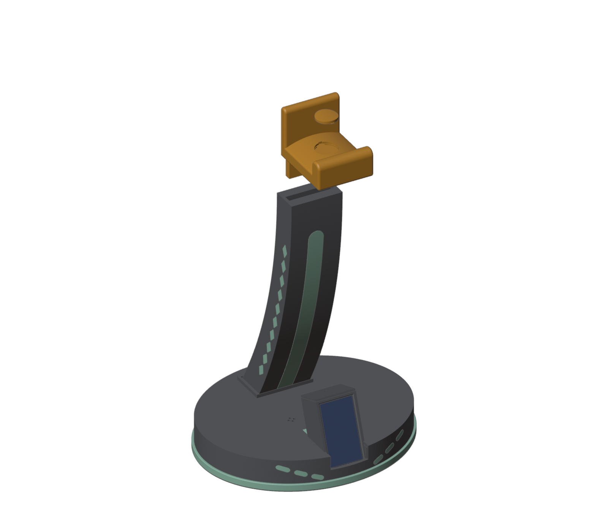

Zapfen der Auflage in die Säule stecken und mit 2 × M3 × 12 von hinten sichern. FSR in die Tasche (Ø 19,4 × 5,25 mm) legen, das schon hochgeführte Kabel durch den Kabeltunnel (8 × 1,25 mm) und den Schacht im Zapfen führen. Druckplatte mit den Nasen in die Einführschlitze setzen und etwa 90° im Uhrzeigersinn drehen, bis sie klickt .

### Schritt 8: Füße
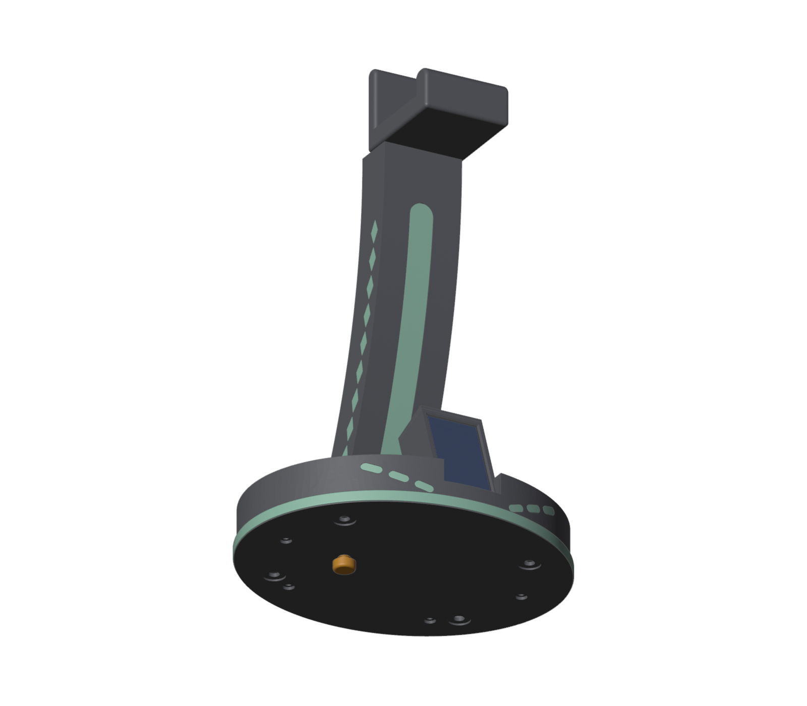

Vier TPU-Füße mit dem Pilzkopf in die Löcher im Boden drücken.

**Was klemmt oder clipst:** Display-Deckel, USB-C-Platine, Front-Inlay, Druckplatte (Bajonett mit Rast), TPU-Füße.

## 5. Schnittbilder

**Mikrofon-Kragen:** 1 mm Luft zwischen Mikrofon und Deck, Kragen Ø 10/7 mm bis z = 13,2 mm, vier Schalllöcher Ø 2,0 mm auf einem Lochkreis mit R = 2,4 mm durch das Deck (z = 25,5 bis 28 mm).

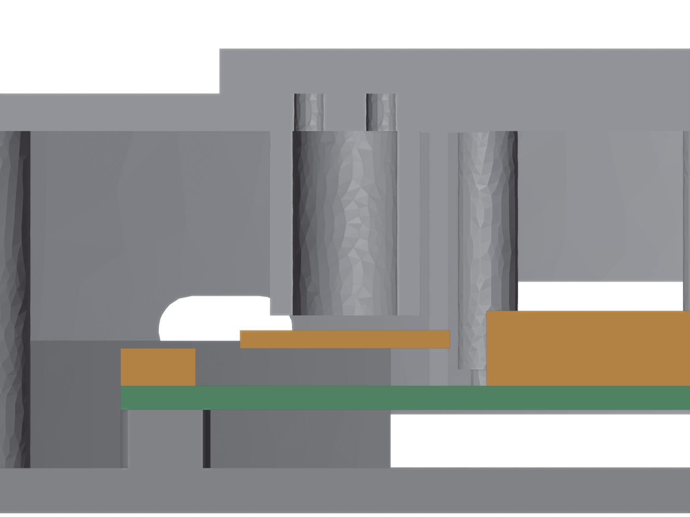

**Bajonett der Druckplatte:** Nut Ø 21 × 0,8 mm, zwei Einführschlitze 3,4 × 1,4 mm, zwei Endanschläge (90°), zwei Rastnoppen mit 0,15 mm Überstand. Fühlt sich der Klick zu lasch oder zu hart an, ändert man `Rast_Ueberstand` (0,1 bis 0,25 mm) in der Konstruktion.

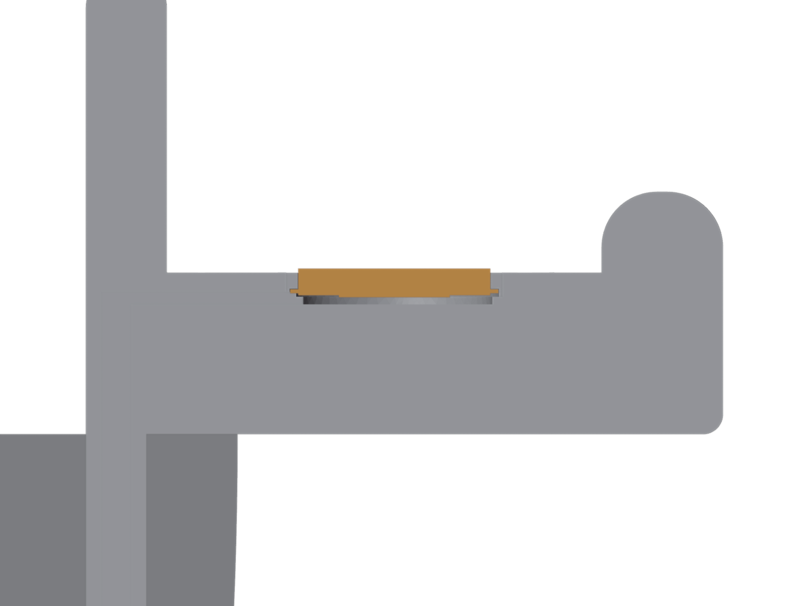

## 6. Wichtige Maße

Alle Maße in mm. Das vollständige Maßblatt mit Ansichten ist die [Maßzeichnung](blueprint.html).

| Maß | Wert |
|---|---|
| Baugruppe (B × T × H) | 184 × 156 × 283 |
| Sockel | 180 × 152, Höhe 63,9 (z 3 bis 66,9), Deck bei z = 28 |
| Boden | 183 × 155 × 11,5 |
| Säule B | 46 × 82,6 × 205 (z 28 bis 233) |
| Auflage | 50 × 63 × 66 (z 213 bis 279), Radien 2 |
| Platine v2 | 64 × 52 × 1,6, Dome M2,5 (Kernloch 2,2) |
| Display-Glas | x ±14,4, y 61 bis 82 |
| USB-C | x ±4,5, y −61,4 bis −54 (hinten) |

Koordinaten: z nach oben, vorne (Displayseite) = +Y, USB-C hinten.

## 7. Offene Punkte

- Es gibt auch Variante A (glatt, `Saeule_v2_A_Glatt.stl` mit `Inlay_Seite_A_*`). Diese Anleitung beschreibt Variante B (Rauten).
- Probedruck von Sockel v9, Säule A/B und Auflage v4 steht noch aus.
- Höhe des eingelöteten INMP441 messen, danach ggf. Mikro-Kragen anpassen.
- Der Deckel enthält in der alten `entwurf-1/DRUCKLISTE.txt` noch den Vermerk „ICS-43434-Halter“. Das ist überholt: Das Mikrofon ist der INMP441 auf der Platine v2.
