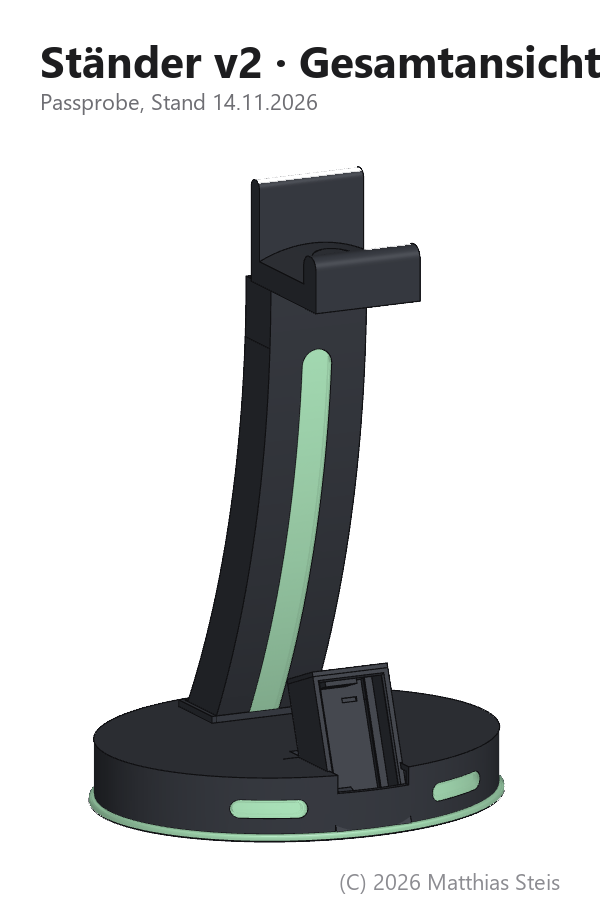
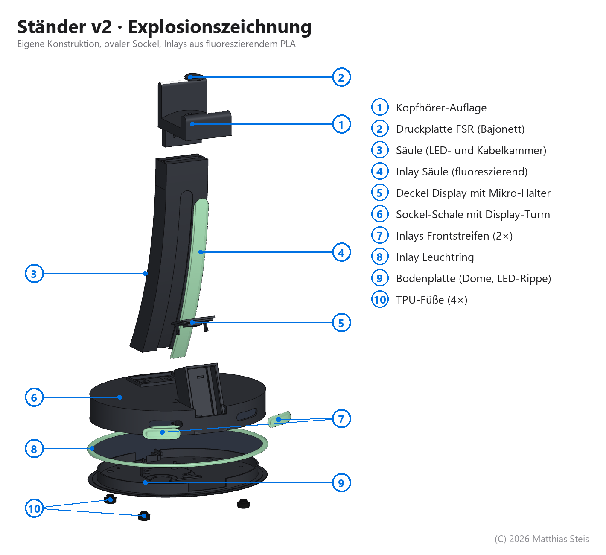

# Ständer v2, Entwurf 1 (14.11.2026)

**Zwischenstand, ungetestet.** Nichts davon ist gedruckt oder geprüft. Die Teile sind ein erster Entwurf für einen komplett neu konstruierten Ständer mit ovalem Sockel. Eine Änderungsrunde läuft schon (Seitenfenster in der Säule, höherer Leuchtring, schräge Front-Inlays, USB-C-Halter mit Stiften und Rastnase). Die Dateien hier bleiben als Stand von Entwurf 1 erhalten.

Eigene Konstruktion, © 2026 Matthias Steis, Lizenz [CC BY-NC-SA 4.0](https://creativecommons.org/licenses/by-nc-sa/4.0/deed.de). Die Teile sind neu gezeichnet und enthalten keine Geometrie aus dem RGB Headphone Stand (Thingiverse 4722406) oder dessen Vorlage. Die Display-Gehäuse (`ESP32_*_Mikro.sc`) bauen auf dem bestehenden Gehäuse in [`../../c6-touch-1.9/`](../../c6-touch-1.9/) auf.

  
  

## Aufbau

- **Sockel:** ovale Schale (90 × 76 mm Halbachsen) mit Bodenplatte, LED-Rippe und Leuchtring von unten. Bodenplatte und Schale werden mit 4 × M3 und Einschmelzmuttern verschraubt.
- **Säule:** gebogen (r 412 mm), 46 mm breit, 205 mm hoch, mit Lichtkammer und Kabelkammer. Der Lichtstreifen vorne ist ein Inlay.
- **Auflage:** Kopfhörer-Auflage mit Druckplatte für einen FSR402 (Kopfhörer-Erkennung, Bajonett).
- **Inlays:** aus fluoreszierendem PLA, 1,2 mm dick im Lichtweg, 0,2 mm Spiel.
- **Füße:** 4 × TPU mit Pilzkopf-Zapfen, rasten im Boden ein.
- **Display-Deckel:** hochkant und quer, jeweils mit Halter für das Mikrofon ICS-43434.

Material, Druckausrichtung und Schrauben stehen in [`DRUCKLISTE.txt`](DRUCKLISTE.txt).

## Dateien

| Art | Dateien |
|---|---|
| Druckteile (STL) | `Auflage_v2`, `Druckplatte_FSR`, `Saeule_v2`, `Sockel_oval_v1`, `Boden_v1`, `ESP32_Lid_Mikro_hochkant`, `ESP32_Lid_Mikro_quer`, `TPU_Fuss_4x`, Inlays (`Inlay_*`) |
| Passprobe | `Passprobe_v2_Saeule_oben.stl`, `Passprobe_v2_Inlay_Saeule_oben.stl` (nur das obere Säulenstück) |
| CAD (SolidCraft) | `Saeule_v2.sc`, `Auflage_v2.sc`, `Staender_v2_Baugruppe.sc` (Sockel, Boden, Inlays, Elektronik), `ESP32_hochkant_Mikro.sc`, `ESP32_quer_Mikro.sc` |
| Bilder | `*.png` |

**Export:** Aus `Staender_v2_Baugruppe.sc` nur die Druckkörper exportieren, die Elektronik ist nur zur Ansicht drin.
