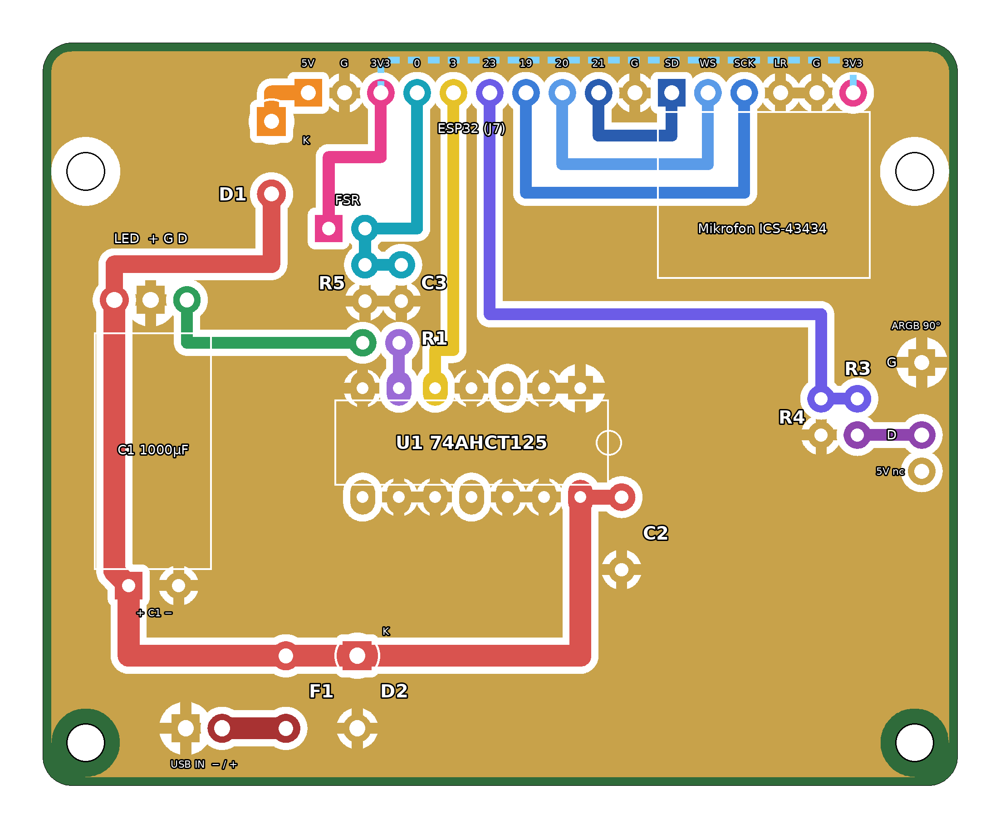

# Platine v2 für den Ständer v2 (mit Kopfhörer-Sensor und Mikrofon)

Status: **Entwurf, noch nicht bestellt und nicht getestet.** Die Firmware für Sensor und Mikrofon fehlt noch.

Die Platine v2 sitzt im neuen ovalen Sockel des Ständers v2 (siehe [`../gehaeuse/staender-v2/`](../gehaeuse/staender-v2/)). Dort ist deutlich mehr Platz als im alten Sockel, deshalb ist sie ein schlichtes Rechteck mit 4 Befestigungslöchern. Gegenüber der [Platine v1](../platine/) kommt Folgendes dazu:

- **Kopfhörer-Sensor:** Anschluss für eine FSR-Drucksensor-Folie (FSR402 o. ä.) unter der Druckplatte in der Kopfhörer-Auflage. Die Folie liegt zwischen 3,3 V und GPIO0, R5 (22 kΩ) zieht nach GND, C3 (100 nF) glättet. Ohne Kopfhörer liegt GPIO0 bei ca. 0 V, mit Kopfhörer je nach Gewicht bei ca. 2–3 V.
- **Mikrofon:** Steckplatz für ein I2S-Mikrofonmodul ICS-43434 (6 Pins) für die Musik-Reaktion. SCK = GPIO19, WS = GPIO20, SD = GPIO21, L/R auf GND (linker Kanal).
- **Schutz am Eingang:** Polyfuse F1 (3,75 A Haltestrom) und TVS-Diode D2 (5 V) direkt hinter dem USB-C-Eingang.
- **Ein Anschluss zum ESP:** Alle Leitungen zum ESP laufen über eine 10-polige Stiftleiste J7 (ein Kabel statt mehrerer).
- **USB-Daten nicht mehr über die Platine:** Für PC-Sync führt das Datenkabel jetzt direkt von der USB-C-Buchsenplatine (Pins 5–6) zum ESP (J3 Pin 12 = GPIO13 = D+, J3 Pin 11 = GPIO12 = D−). Es bleibt der Schalter: gesteckt PC-Sync, abgezogen nur Strom.

Ansicht von der Bauteilseite. Gelb ist die Massefläche (GND), die farbigen Bahnen sind die übrigen Netze (Kupfer unten). Die hellblau gestrichelte Linie oben ist die einzige Bahn auf der Bauteilseite (3V3 zum Mikrofon).

## Maße und Einbau

- Größe **64 × 52 mm**, Ecken mit 2 mm gerundet. Koordinaten wie im SolidCraft-Modell: Ursprung = Mitte des Sockels, +y zeigt zum Display.
- Umriss x −32…32, y −22…30.
- 4 Befestigungslöcher Ø 2,7 mm für M2,5 bei (−29/−19), (29/−19), (−29/21), (29/21). Die Dome im Sockel-Boden müssen an diese Stellen.
- Bis zur Sockeldecke sind über der Platine ca. 17 mm frei. Die höchsten Bauteile sind F1 (radial, je nach Hersteller bis ca. 15 mm mit Beinchen) und D2 (stehend, ca. 12 mm). Wird es zu eng, F1 vor dem Einlöten flach umlegen (die Beinchen sind lang genug). C1 liegt.
- Das Mikrofonmodul liegt flach auf einer kurzen Stiftleiste über dem markierten Feld rechts (x 11…25,9, y 13,5…25,2), mit ca. 1,5 mm Abstand zum Schraubenkopf bei (29/21). Darüber braucht der Sockel eine Schallöffnung.
- **J7 nicht als gerade Stiftleiste mit Dupont-Stecker** (zu hoch): 90°-Stiftleiste nach vorne oder Litze direkt einlöten, am ESP-Ende Dupont-Buchsen.
- J4 (ARGB, 90°-Stiftleiste) zeigt an der rechten Kante nach außen.

## Dateien

| Datei | Zweck |
|---|---|
| `out/platine_v2_gerber.zip` | **Fertigungsdaten zum Hochladen beim Leiterplatten-Shop** (Gerber + Bohrdateien) |
| `out/platine_v2_bestueckung.png` | Bestückungsplan |
| `out/platine_v2_aetzvorlage_A4.pdf` | Ätzvorlage 1:1, zwei Kopien auf A4. Mit 100 % drucken. |
| `out/platine_v2_aetzvorlage_600dpi.png` | Dieselbe Vorlage als Bild |
| `gen_platine_v2.py` | Erzeugt alles neu: `pip install shapely pillow`, dann `python3 docs/hardware/platine-v2/gen_platine_v2.py` |

Das Skript prüft beim Erzeugen die Abstände zwischen den Netzen und zur Massefläche (mindestens 0,45 mm), zum Rand und zu den Befestigungslöchern, dass jedes Netz durchgehend verbunden ist und dass die Massefläche zusammenhängt. Aktuell: keine Probleme, eine zusammenhängende Massefläche.

## Online bestellen

`out/platine_v2_gerber.zip` beim Shop hochladen (z. B. AISLER). Optionen wie bei v1: **2 Lagen, FR-4, 1,6 mm, 35 µm Kupfer, HASL bleifrei, Lötstopp grün, Bestückungsdruck weiß**. Kleinste Bohrung 0,8 mm, kleinster Abstand 0,45 mm, Bahnbreite ab 0,8 mm.

| Datei | Lage |
|---|---|
| `platine-v2-F_Cu.gtl` | Kupfer oben: Lötaugen und die 3V3-Bahn zum Mikrofon |
| `platine-v2-B_Cu.gbl` | Kupfer unten: Leiterbahnen und Massefläche |
| `platine-v2-F_Mask.gts`, `platine-v2-B_Mask.gbs` | Lötstopplack oben/unten |
| `platine-v2-F_SilkS.gto` | Bestückungsdruck (Bauteilnamen, Pinbelegung, Polung, Copyright) |
| `platine-v2-Edge_Cuts.gm1` | Umriss |
| `platine-v2-PTH.drl`, `platine-v2-NPTH.drl` | Bohrungen durchkontaktiert / ohne Kupfer (4 × M2,5) |

## Selbst ätzen

Die Ätzvorlage zeigt die Unterseite von der Bauteilseite aus gesehen, also **nicht spiegeln**. Prüfmaß 64,0 × 52,0 mm. Die Bahn auf der Bauteilseite (3V3 von J7 Pin 3 zu J6 Pin 6) als isolierten Draht oben einlöten. GND-Brücken sind diesmal nicht nötig.

## Bauteile

| Teil | Wert | Montage |
|---|---|---|
| U1 | 74AHCT125 (DIP-14) | Kerbe nach rechts, Pin 1 oben rechts (eckiges Pad). IC-Fassung passt. |
| C1 | 1000 µF / 10 V, Elko Ø 8,2 × 16,7 mm, Raster 3,5 | **liegend** links, Körper nach oben (Richtung LED-Anschluss). Plus ins eckige Pad. |
| C2 | 100 nF Keramik, Raster 5,08 | neben U1 Pin 14 |
| C3 | 100 nF Keramik, Raster 2,54 | neben R5 (Sensor-Glättung) |
| R1 | 330 Ω | stehend über U1 |
| R3 | 1 kΩ | stehend, nur für den ARGB-Eingang |
| R4 | 2 kΩ | stehend, nur für den ARGB-Eingang |
| R5 | 22 kΩ | stehend, Spannungsteiler für den FSR-Sensor |
| D1 | 1N5819 | stehend, Körper über dem runden Pad (Anode), Ring ins eckige Pad (Kathode) |
| D2 | SA5.0A (TVS, DO-15) | stehend, Körper über dem runden Pad (Anode, GND), Ring ins eckige Pad (Kathode, +5 V) |
| F1 | Polyfuse RXEF375 (3,75 A halten, 7,5 A auslösen), radial, Raster 5,1 | beliebig herum. Der Haltestrom sinkt mit der Temperatur (bei ca. 40 °C im Sockel etwa 3,2 A), das reicht für 2,4 A LEDs + ESP. Die RXEF300 wäre warm zu knapp. |
| J1 | Litze ≥ AWG 22 direkt einlöten | USB-Eingang: − = GND, + = VBUS der USB-C-Buchsenplatine (Pins 1–2 der 8er-Leiste). Kein dünnes Jumperkabel, es fließen bis ca. 2,7 A. |
| LED | Pads 1×3 | Pigtail mit JST-SM zum Streifen: +, G, D |
| J4 | Stiftleiste 1×4, 90° | ARGB vom Mainboard (5V nc, D, Lücke, G). Dritten Stift vor dem Einlöten ziehen. |
| J5 | Stiftleiste 1×2 oder Litze | FSR-Folie (Polung egal) |
| J6 | Stiftleiste 1×6 (kurz) | Mikrofonmodul ICS-43434, flach liegend |
| J7 | 90°-Stiftleiste 1×10 oder Litze | Kabel zum ESP (siehe unten) |

## Anschluss ESP (J7)

| J7 Pin | Signal | ESP32-C6-Touch-LCD-1.9 |
|---|---|---|
| 1 | 5V (VESP, hinter D1) | J4 Pin 1 (VBUS) |
| 2 | GND | J4 Pin 3 (GND) |
| 3 | 3V3 | J4 Pin 5 (3V3) |
| 4 | GPIO0 (FSR) | J3 Pin 4 |
| 5 | GPIO3 (LED-Daten) | J3 Pin 7 |
| 6 | GPIO23 (ARGB-Eingang) | J4 Pin 9 |
| 7 | GPIO19 (I2S SCK) | J3 Pin 17 |
| 8 | GPIO20 (I2S WS) | J3 Pin 19 |
| 9 | GPIO21 (I2S SD) | J3 Pin 20 |
| 10 | GND | J3 Pin 18 (GND) |

## Mikrofon (J6)

Reihenfolge auf der Platine: SD, WS, SCK, L/R, GND, 3V3. **Die Pinreihenfolge der ICS-43434-Module ist je nach Hersteller verschieden.** Vor der Bestellung mit dem tatsächlich gekauften Modul abgleichen und ggf. im Skript (`J6`, `J6N`) anpassen.

## Offen

- Pinreihenfolge des gekauften Mikrofonmoduls bestätigen.
- Dome, Schallöffnung über dem Mikrofon und Kabeldurchführungen im Sockel v2 an die neue Platine anpassen.
- Firmware: Kopfhörer-Erkennung (GPIO0, Schwellwert mit Hysterese) und Musik-Reaktion (I2S).
