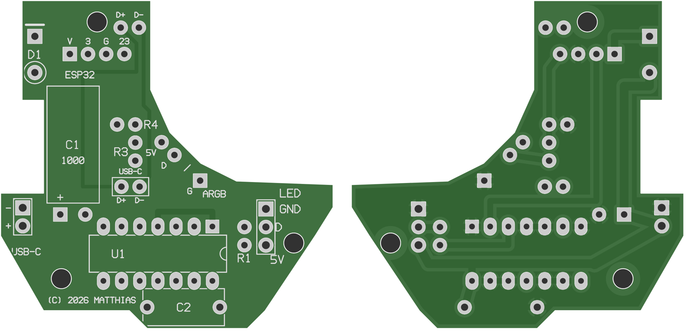

# Platine für den Sockel (bedrahtet, zum Bestellen oder Selbstätzen)

Die Platine ersetzt den Breadboard-Aufbau und die WAGO-Klemmen. Sie sitzt im Sockel (Base_Box) in der Mitte zwischen den drei Diffusorscheiben, mit einer Zunge Richtung ESP-Gehäuse. Die Lichtöffnungen bleiben frei.

Ansicht von der Bauteilseite. Gelb ist die Massefläche (GND), die farbigen Bahnen sind die übrigen Netze. Das Kupfer liegt unten.

## Dateien

| Datei | Zweck |
|---|---|
| `out/platine_aetzvorlage_A4.pdf` | Ätzvorlage 1:1, zwei Kopien auf A4. Mit 100 % drucken, nicht „an Seite anpassen“. |
| `out/platine_aetzvorlage_600dpi.png` | Dieselbe Vorlage als Bild |
| `out/platine_bestueckung.png` | Bestückungsplan |
| `out/platine_gerber.zip` | **Fertigungsdaten zum Hochladen beim Leiterplatten-Shop** (Gerber + Bohrdateien, siehe unten) |
| `out/platine_gerber_vorschau.png` | So sieht die bestellte Platine aus (links oben, rechts unten) |
| `gen_platine.py` | Erzeugt alles neu: `pip install shapely pillow`, dann `python3 docs/hardware/platine/gen_platine.py` |

Das Skript prüft beim Erzeugen die Abstände zwischen den Netzen (mindestens 0,45 mm), zum Rand und zu den Befestigungslöchern. Außerdem prüft es, dass alle GND-Pads an einer zusammenhängenden Massefläche hängen.

## Online bestellen

`out/platine_gerber.zip` beim Shop hochladen (z. B. AISLER, JLCPCB). Inhalt:

| Datei | Lage |
|---|---|
| `platine-F_Cu.gtl` | Kupfer oben: Lötaugen (damit die Bohrungen durchkontaktiert sind) die USB-Datenleitungen und eine kurze GND-Brücke (U1 Pin 4 → Pin 1) |
| `platine-B_Cu.gbl` | Kupfer unten: Leiterbahnen und Massefläche |
| `platine-F_Mask.gts`, `platine-B_Mask.gbs` | Lötstopplack oben/unten |
| `platine-F_SilkS.gto` | Bestückungsdruck oben (Bauteilnamen, Anschlussnamen, Umrisse, Polung, Copyright) |
| `platine-Edge_Cuts.gm1` | Umriss |
| `platine-PTH.drl`, `platine-NPTH.drl` | Bohrungen durchkontaktiert / ohne Kupfer (3 × M2,5) |

Bestelloptionen: **2 Lagen, FR-4, 1,6 mm, 35 µm Kupfer, HASL bleifrei, Lötstopp grün, Bestückungsdruck weiß**. Größe 46,5 × 46,0 mm, kleinste Bohrung 0,8 mm, kleinster Abstand 0,45 mm, Bahnbreite ab 0,8 mm. Das schafft jeder Standardprozess.

## Selbst ätzen

Die Ätzvorlage enthält nur die Unterseite. Die USB-Datenleitungen und die GND-Brücke von U1 Pin 4 zu Pin 1 liegen oben. Beim Selbstätzen die GND-Brücke **immer** als Draht auf der Bauteilseite einlöten (sonst hängt ein Teil der Massefläche lose), die USB-Datenleitungen nur bei Bedarf.

- **Tonertransfer oder Belichten:** Die Vorlage zeigt das Kupfer so, wie man von der Bauteilseite durch die Platine schaut. So drucken, wie sie ist, also **nicht spiegeln**. Beim Aufbügeln bzw. Auflegen mit der Druckseite aufs Kupfer stimmt die Lage dann.
- **Prüfmaß:** Die Platine ist 46,5 × 46,0 mm groß (Außenmaß inkl. Zunge, die oben links auf 18 mm verbreitert ist). Nach dem Drucken mit dem Messschieber kontrollieren.
- **Bahnen:** 5 V 1,5 mm breit, Signale 0,8 mm, Abstand zur Massefläche 0,5 mm. Die Bohrlöcher haben in der Ätzvorlage einen kleinen freien Punkt als Körnung (in den Gerber-Daten nicht).
- **Bohren:** 0,8 mm (IC), 0,9 mm (R, C, Stiftleisten), 1,0 mm (D1, DIN), 1,1 mm (Strom-Stiftleisten USB-C und LED), 2,7 mm (Befestigung M2,5).

## Bauteile

| Teil | Wert | Montage |
|---|---|---|
| U1 | 74AHCT125 (DIP-14) | Kerbe zeigt nach rechts (zu den Streifen-Anschlüssen). Pin 1 oben rechts, eckiges Pad. Eine IC-Fassung passt in der Höhe. |
| D1 | 1N5819 | **stehend** links oben in der verbreiterten Zunge, Körper über dem runden Pad (Anode), Ring (Kathode) ins eckige Pad oben. Abstand zur ESP-Stiftleiste ca. 3,5 mm. |
| R1 | 330 Ω | stehend, rechts neben U1 (ca. 1 mm Luft zu einer IC-Fassung) |
| R3 | 1 kΩ | stehend |
| R4 | 2 kΩ | stehend |
| C2 | 100 nF, Folienkondensator CY630 104J (11,5 × 10,3 × 5,4 mm) | Raster 10,16 mm, **stehend** direkt unter U1. Das Pad rechts (an U1 Pin 14) ist +5 V, die Polung ist bei Folienkondensatoren aber egal. |
| C1 | 1000 µF, Elko Ø 8,2 × 16,7 mm, Raster 3,5 mm | **liegend** in der Zunge, Körper Richtung ESP-Anschluss. Beine 90° abwinkeln: Plus ins eckige Pad links, Minus rechts. |

Anschlüsse (alle im 2,54-mm-Raster für Stiftleisten und Dupont-Stecker, gerade oder 90°):

| Pads | Wohin |
|---|---|
| USB-C +5V / GND (links, Stiftleiste 1×2, 2,54 mm, gerade) | Dupont-Kabel zu VBUS/GND der USB-C-Buchsenplatine (Pins 1–2 der 8er-Leiste). Für bis zu 2,4 A **kein dünnes Jumperkabel**, sondern Litze ≥ AWG 22 mit selbst gecrimpten Dupont-Hülsen (Kontakte ca. 3 A). Alternativ Litze bis 0,75 mm² direkt einlöten. |
| LED +5V / DIN / GND (rechts, 1×3 im 2,54-mm-Raster) | **Im Sockel:** Über dem Anschluss liegt die Diffusorscheibe (nur ca. 13 mm frei), und 90°-Stecker stoßen an Sockelwand bzw. R1/U1. Deshalb ein kurzes Kabel mit dem **JST-SM-Gegenstück** des Streifens anlöten (Pigtail, Litze ≥ AWG 22 für +5V/GND). Der Streifen wird dann dort eingesteckt. Außerhalb des Sockels (Test) passt auch eine Stiftleiste mit Dupont. |
| ESP VBUS / IO3 / GND / IO23 (Zungenspitze, Stiftleiste 1×4) | Im Sockel ist über der Zungenspitze wenig Höhe: Stiftleiste mit Litze oben angelötet oder Litze direkt einlöten, am ESP-Ende Dupont-Buchse. Zu J4 Pin 1, J3 Pin 7, J4 Pin 3, J4 Pin 9 des ESP32-C6-Touch-LCD-1.9 |
| USB D+ / D− (Stiftleiste 1×2, 2,54 mm, rechts neben C1) | Zweites Dupont-Kabel zu D−/D+ der Buchsenplatine (Pins 5–6), verdrillt. **Das Kabel ist der Schalter:** gesteckt PC-Sync über die Sockel-Buchse (Adalight, siehe Haupt-README), abgezogen nur Strom. Zum Flashen über die ESP-Buchse abziehen. |
| ESP D+ / D− (Zungenspitze rechts, Stiftleiste 1×2, 2,54 mm) | Wie der ESP-Anschluss: auf der Platine gelötet, am ESP-Ende Dupont. Zu J3 Pin 12 (GPIO13 = D+) und J3 Pin 11 (GPIO12 = D−), kurz und verdrillt. |
| ARGB G / – / D / 5V (Zunge) | Raster wie der 3-polige ARGB-Stecker vom Mainboard (5V, D, Lücke, G). Stiftleiste 1×4 einlöten und den dritten Stift (Lücke) ziehen, dann passt der Stecker direkt. Das 5V-Pad hält nur den Stift und ist nicht angeschlossen. |

## Unterschiede zum Breadboard-Plan

- **Unbenutzte Kanäle des 74AHCT125:** Hier liegen OE und A der Kanäle 2 bis 4 auf GND, auf dem Breadboard liegen die OE-Pins auf +5 V. Beides ist zulässig. Auf GND aktiviert die Ausgänge, die dann fest auf Low liegen und nirgends angeschlossen sind. So spart die einseitige Platine Brücken.
- **C1 (1000 µF):** sitzt direkt an der USB-C-Einspeisung. Stehend wäre er zu hoch, deshalb liegt er in der verlängerten Zunge. D1 ist dafür nach oben in die links verbreiterte Zungenspitze gewandert, mit Abstand zum ESP-Anschluss.
- Die WAGO-Klemmen entfallen. Die Platine verteilt +5 V und GND.

## Einbau

- **USB-C-Buchsenplatine:** Die 8er-Stiftleiste bleibt drauf (Stifte nach oben). GND, VBUS, D− und D+ (Pins 1, 2, 5, 6) oben an die Stifte anlöten und seitlich zur Platine führen, gesteckt ist dort zu hoch. Auf der Platine stecken sie mit Dupont auf den beiden USB-Stiftleisten.

- **Höhe der Stecker:** Auf der Platine passen gerade Stiftleisten mit Dupont-Hülse (ca. 16,5 mm hoch), weil darüber eine Diffusoröffnung liegt. Auf der USB-C-Buchsenplatine ist dafür kein Platz (Diffusor ca. 12 mm darüber), dort die Kabel direkt anlöten.

- Drei Befestigungslöcher M2,5 bei (−5/−6), (27,5/−1) und (0/30) mm, passend zu den Domen im Sockel-Vorschlag (`ESP32-Umbau\Passprobe\Vorschlag_Platine\`). Die Unterseite der Platine liegt 4 mm über dem Sockelboden.
- Bauhöhe über der Platine höchstens 13 mm, außer an den beiden USB-Stiftleisten (unter der Diffusoröffnung, gesteckt ca. 16,5 mm). Mit stehenden Widerständen und der stehenden Diode bleibt alles unter ca. 11 mm. Am höchsten ist C2 mit 10,3 mm.
- Statt CY630 passt auch ein Keramik-Vielschichtkondensator 100 nF, 50 V, X7R mit Raster 5,08 mm (z. B. KEMET C320C104K5R5TA). Dessen Beine auf 10,16 mm aufbiegen.
