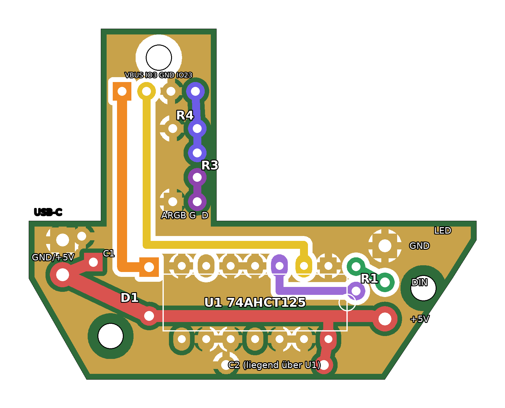

# Platine für den Sockel (einseitig, bedrahtet)

Die Platine ersetzt den Breadboard-Aufbau und die WAGO-Klemmen. Sie sitzt im Sockel (Base_Box) in der Mitte zwischen den drei Diffusorscheiben, mit einer Zunge Richtung ESP-Gehäuse. Die Lichtöffnungen bleiben frei.

Ansicht von der Bauteilseite. Gelb ist die Massefläche (GND), die farbigen Bahnen sind die übrigen Netze. Das Kupfer liegt unten.

## Dateien

| Datei | Zweck |
|---|---|
| `out/platine_aetzvorlage_A4.pdf` | Ätzvorlage 1:1, zwei Kopien auf A4. Mit 100 % drucken, nicht „an Seite anpassen“. |
| `out/platine_aetzvorlage_600dpi.png` | Dieselbe Vorlage als Bild |
| `out/platine_bestueckung.png` | Bestückungsplan |
| `out/platine-B_Cu.gbl`, `out/platine-Edge_Cuts.gm1`, `out/platine.drl` | Gerber und Bohrdatei, falls die Platine doch bestellt oder gefräst wird |
| `gen_platine.py` | Erzeugt alles neu: `pip install shapely pillow`, dann `python3 docs/hardware/platine/gen_platine.py` |

Das Skript prüft beim Erzeugen die Abstände zwischen den Netzen (mindestens 0,45 mm), zum Rand und zu den Befestigungslöchern. Außerdem prüft es, dass alle GND-Pads an einer zusammenhängenden Massefläche hängen.

## Ätzen

- **Tonertransfer oder Belichten:** Die Vorlage zeigt das Kupfer so, wie man von der Bauteilseite durch die Platine schaut. So drucken, wie sie ist, also **nicht spiegeln**. Beim Aufbügeln bzw. Auflegen mit der Druckseite aufs Kupfer stimmt die Lage dann.
- **Prüfmaß:** Die Platine ist 46,5 × 36,5 mm groß (Außenmaß inkl. Zunge). Nach dem Drucken mit dem Messschieber kontrollieren.
- **Bahnen:** 5 V 1,5 mm breit, Signale 0,8 mm, Abstand zur Massefläche 0,5 mm. Die Bohrlöcher haben einen kleinen freien Punkt als Körnung.
- **Bohren:** 0,8 mm (IC), 0,9 mm (R, C, Stiftleisten), 1,0 mm (D1, DIN), 1,3 mm (Litze 1 mm² für USB-C und Streifen), 2,7 mm (Befestigung M2,5).

## Bauteile

| Teil | Wert | Montage |
|---|---|---|
| U1 | 74AHCT125 (DIP-14) | Kerbe zeigt nach rechts (zu den Streifen-Anschlüssen). Pin 1 oben rechts, eckiges Pad. Direkt einlöten, ohne IC-Fassung, weil C2 darauf liegt. |
| D1 | 1N5819 | **stehend**, Ring (Kathode) ins eckige Pad oben |
| R1 | 330 Ω | stehend |
| R3 | 1 kΩ | stehend |
| R4 | 2 kΩ | stehend |
| C2 | 100 nF, Folienkondensator CY630 104J (11,5 × 10,3 × 5,4 mm) | Raster 10,16 mm. **Liegend über U1** einlöten: Beine 90° abwinkeln, Körper flach auf den IC legen. Das Pad rechts (an U1 Pin 14) ist +5 V. |
| C1 | 1000 µF, 6,3 V, Low-ESR, **Ø 8 × 11,5 mm** (kurze Bauform) | **liegend** in der Zunge links, Körper nach oben Richtung ESP-Anschluss. Beine abwinkeln: Plus ins eckige Pad neben USB +5V, Minus ins runde Pad neben USB GND. Ein längerer Elko (z. B. Ø 8 × 16) passt nicht in den Sockel. |

Anschlüsse (Lötpads, im 2,54-mm-Raster, Stiftleisten bzw. T-Pfosten passen auch):

| Pads | Wohin |
|---|---|
| USB-C +5V / GND (links, große Pads) | Litze 1 mm² zu VBUS und GND der USB-C-Buchse |
| LED +5V / DIN / GND (rechts) | Streifen. +5V und GND mit Litze 1 mm². |
| ESP VBUS / IO3 / GND / IO23 (Zungenspitze) | J4 Pin 1, J3 Pin 7, J4 Pin 3, J4 Pin 9 des ESP32-C6-Touch-LCD-1.9 |
| ARGB G / D (Zunge) | Mainboard-ARGB-Header: G und D. Den 5V-Pin des Headers nicht anschließen. |

## Unterschiede zum Breadboard-Plan

- **Unbenutzte Kanäle des 74AHCT125:** Hier liegen OE und A der Kanäle 2 bis 4 auf GND, auf dem Breadboard liegen die OE-Pins auf +5 V. Beides ist zulässig. Auf GND aktiviert die Ausgänge, die dann fest auf Low liegen und nirgends angeschlossen sind. So spart die einseitige Platine Brücken.
- **C1 (1000 µF):** sitzt direkt an der USB-C-Einspeisung. Stehend wäre jeder 1000-µF-Elko zu hoch, deshalb liegt er. Nur die kurze Bauform Ø 8 × 11,5 mm hat liegend zwischen den Bauteilen und den Diffusorscheiben Platz.
- Die WAGO-Klemmen entfallen. Die Platine verteilt +5 V und GND.

## Einbau

- Drei Befestigungslöcher M2,5 passen zu den Domen im Sockel-Vorschlag (`ESP32-Umbau\Passprobe\Vorschlag_Platine\`). Die Unterseite der Platine liegt 4 mm über dem Sockelboden.
- Bauhöhe über der Platine höchstens 13 mm. Mit stehenden Widerständen und der stehenden Diode bleibt alles unter ca. 11 mm. C2 liegt auf U1, die Oberkante kommt dann auf etwa 10,5 mm. Mit IC-Fassung wären es etwa 14 mm, das ist zu hoch.
- Statt CY630 passt auch ein Keramik-Vielschichtkondensator 100 nF, 50 V, X7R mit Raster 5,08 mm (z. B. KEMET C320C104K5R5TA). Dessen Beine auf 10,16 mm aufbiegen oder die Pads anpassen.
