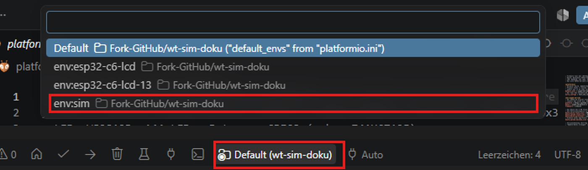
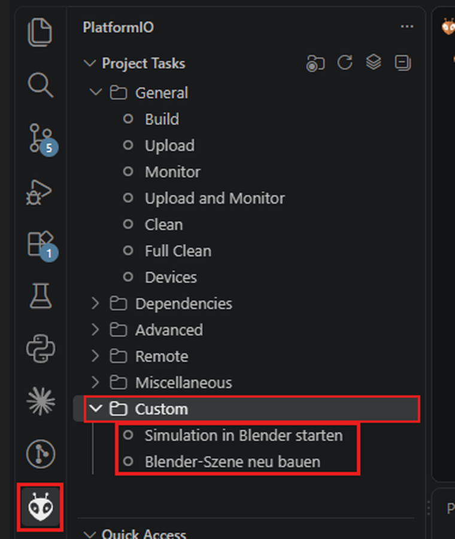
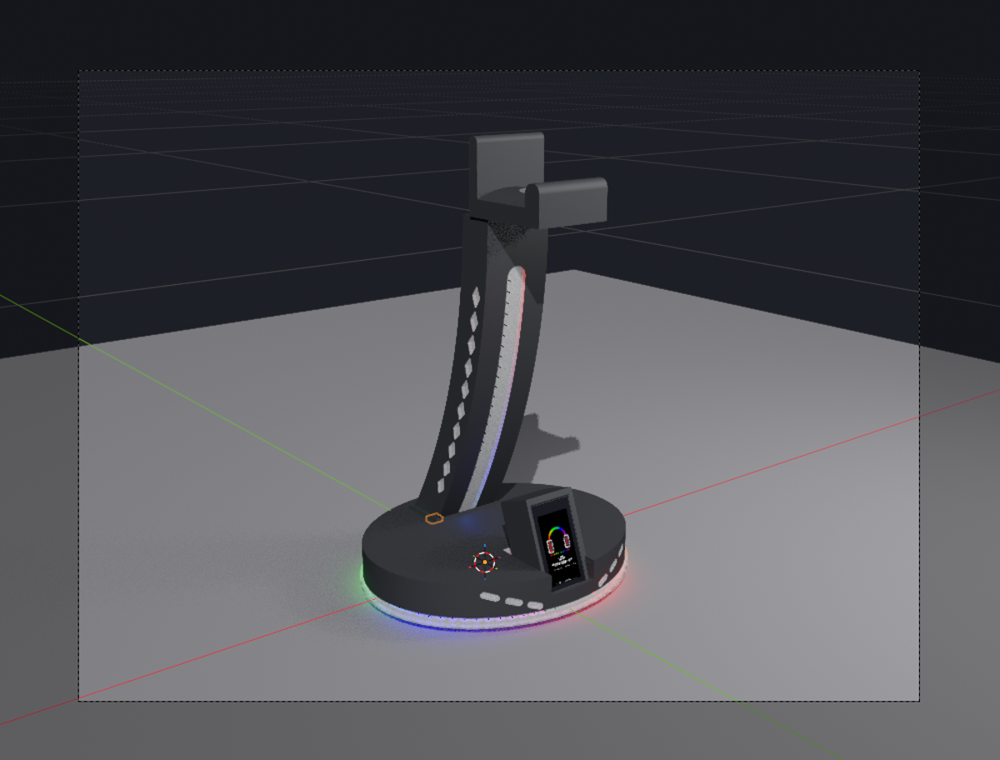
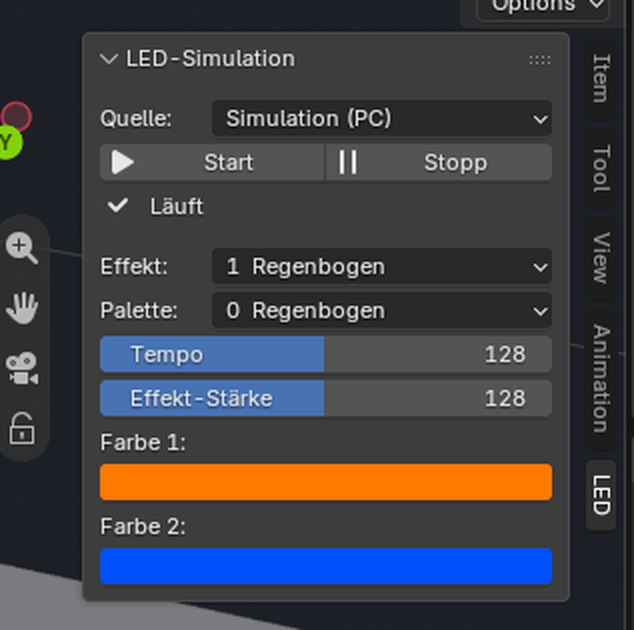
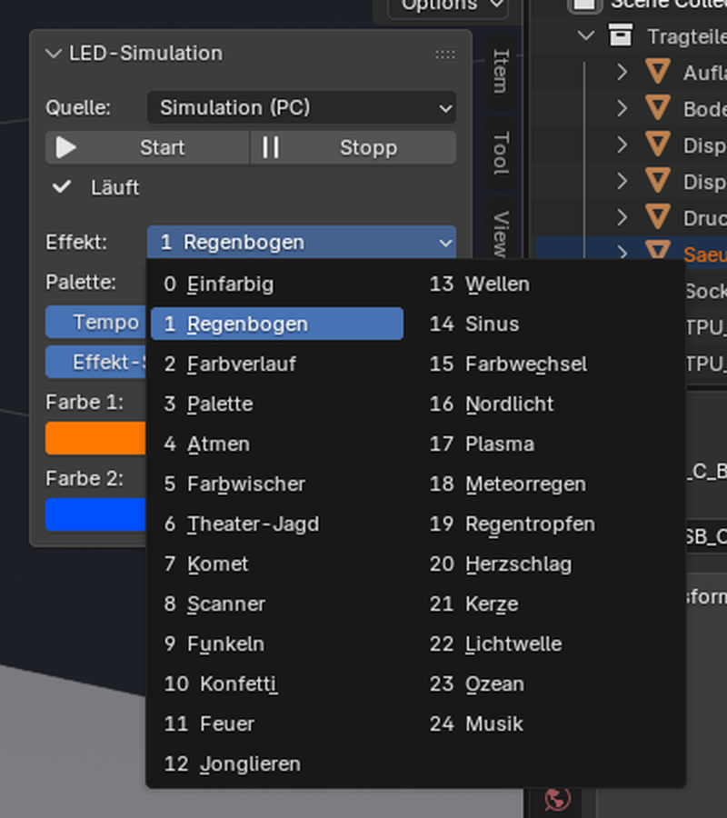
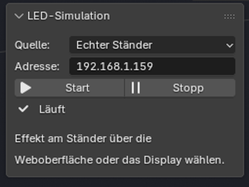

# Simulation in Blender: Schritt für Schritt

Mit der Simulation siehst du die LED-Effekte am 3D-Modell des Ständers, **ohne Ständer und ohne Flashen**. Der PC rechnet die Effekte mit genau demselben Code wie die Firmware. Blender zeigt das Ergebnis: Jede der 144 LEDs leuchtet an ihrer echten Stelle, und das Display zeigt das Startbild.

Du kannst Blender genauso mit dem **echten Ständer** verbinden. Dann leuchten die LEDs im Modell so wie am Ständer.

> **Kurz gesagt:** In VS Code unten `env:sim` wählen, links bei PlatformIO auf **„Simulation in Blender starten“** klicken, in Blender die Taste **N** drücken, im Reiter **„LED“** einen Effekt auswählen. Fertig.

---

## Was wofür ist

| Programm | Aufgabe |
|---|---|
| **VS Code mit PlatformIO** | baut die Simulation und startet Blender per Klick |
| **Simulation** (`.pio/build/sim/program.exe`) | rechnet die Effekte, läuft unsichtbar im Hintergrund |
| **Blender** | zeigt den Ständer in 3D; dort wählst du Effekt, Palette, Tempo und Farben |

Du musst nur VS Code bedienen und danach Blender. Die Simulation startet und beendet sich von selbst.

---

## Einmalig einrichten

Das ist nur einmal pro PC nötig. Auf Matthias' PC ist alles schon erledigt.

1. **Blender installieren** (kostenlos, [blender.org](https://www.blender.org/download/)), Version 4.2 oder neuer, mit dem normalen Installer. Die Aufgaben finden Blender unter `C:\Program Files\Blender Foundation\` von selbst. Bei Store-, Steam- oder ZIP-Version die Umgebungsvariable `BLENDER` auf die `blender.exe` setzen.
2. **C++-Compiler installieren.** Er übersetzt die Simulation für den PC.
   - [w64devkit](https://github.com/skeeto/w64devkit/releases) herunterladen (die Datei `w64devkit-x64-….7z.exe`) und nach `C:\w64devkit` entpacken.
   - `C:\w64devkit\bin` zum Benutzer-PATH hinzufügen: Windows-Taste, „Umgebungsvariablen für dieses Konto bearbeiten“, `Path` → Bearbeiten → Neu.
   - VS Code danach einmal neu starten.
3. **3D-Teile:** Die STL-Dateien der Teile (Export aus SolidCraft in Montageposition, Stand Sockel v8) liegen schon im Repo unter `tools/blender/stl/`. Nach einem neuen CAD-Stand dort mit denselben Dateinamen ersetzen (Liste in `tools/blender/build_staender_blend.py` unter `PARTS`).
4. **Szene bauen:** in VS Code die Aufgabe **„Blender-Szene neu bauen“** ausführen (wie in Schritt 2 unten, nur die andere Aufgabe). Danach gibt es die Datei `tools/blender/Staender_v8.blend`.

> **Gut zu wissen:** Schritt 4 wiederholst du immer dann, wenn sich die Konstruktion geändert hat und neue STLs im Ordner liegen. Die LEDs und das Bedienfeld bleiben dabei gleich.

---

## Simulation starten

### Schritt 1: Umgebung `env:sim` wählen

Unten in der blauen Statusleiste von VS Code steht die aktive Umgebung, normalerweise `env:esp32-c6-lcd`. Darauf klicken und **`env:sim`** auswählen.

> **Warum?** `env:sim` baut die Effekte für den PC statt für den ESP32. Zum Flashen später wieder `env:esp32-c6-lcd` wählen.

### Schritt 2: Aufgabe „Simulation in Blender starten“

Links auf das **PlatformIO-Symbol** (Ameisenkopf) klicken. Unter **Project Tasks** stehen die Aufgaben der Umgebung, die unten in der Statusleiste gewählt ist (hier `env:sim`). Die Gruppe **Custom** aufklappen und auf **„Simulation in Blender starten“** klicken.

Unten im Terminal läuft jetzt der Bau. Beim ersten Mal dauert das etwa eine Minute, danach nur Sekunden. Dann öffnet sich Blender, und im Terminal steht `SUCCESS`.

> **Was passiert dabei?** PlatformIO übersetzt die Simulation, zeichnet das Display-Startbild als Bild und startet Blender mit dem Ständer. Die Effekte laufen sofort.

### Schritt 3: Blender, der Ständer leuchtet

Blender zeigt den Ständer aus Kamerasicht. Die LEDs laufen schon, zu Beginn mit dem Effekt „Regenbogen“.

> **Ansicht drehen:** mittlere Maustaste gedrückt halten und ziehen. **Zoomen:** Mausrad. **Zurück zur Kamera:** Taste `0` auf dem Ziffernblock.

### Schritt 4: Bedienfeld öffnen (Taste N)

Mit der Maus über die 3D-Ansicht gehen und **N** drücken. Rechts klappt die Seitenleiste auf. Dort den Reiter **„LED“** anklicken.

### Schritt 5: Effekt und Einstellungen wählen

| Feld | Wirkung |
|---|---|
| **Quelle** | „Simulation (PC)“ oder „Echter Ständer“ |
| **Start / Stopp** | Anzeige starten oder anhalten |
| **Effekt** | Liste aller Effekte, gleiche Nummern wie in der Weboberfläche |
| **Palette** | Farbpalette für Palettenbasierte Effekte |
| **Tempo** | 0 = steht, 255 = sehr schnell |
| **Effekt-Stärke** | je nach Effekt Dichte, Schweiflänge, Anzahl … |
| **Farbe 1 / Farbe 2** | für Einfarbig, Atmen, Komet, Scanner … |

Jede Änderung wirkt sofort.

### Schritt 6: Beenden

Einfach Blender schließen. Die Simulation beendet sich mit. Zum Anhalten ohne Schließen: **Stopp**.

---

## Mit dem echten Ständer verbinden

1. Ständer einschalten, PC im selben WLAN.
2. Im Bedienfeld **Quelle → „Echter Ständer“** wählen.
3. Bei **Adresse** `led-kopfhoerer.local` lassen oder die IP eintragen (steht am Display unter Einrichten, z. B. `192.168.1.159`).
4. **Start** klicken.

Jetzt zeigt das Modell, was der Ständer gerade zeigt. Den Effekt wählst du dann wie gewohnt in der Weboberfläche oder am Display. Ein Gerätepasswort ist dafür nicht nötig, Blender liest nur.

---

## Liste der Effekte und Paletten

| Nr. | Effekt | Nr. | Effekt | Nr. | Effekt |
|---|---|---|---|---|---|
| 0 | Einfarbig | 9 | Funkeln | 18 | Meteorregen |
| 1 | Regenbogen | 10 | Konfetti | 19 | Regentropfen |
| 2 | Farbverlauf | 11 | Feuer | 20 | Herzschlag |
| 3 | Palette | 12 | Jonglieren | 21 | Kerze |
| 4 | Atmen | 13 | Wellen | 22 | Lichtwelle |
| 5 | Farbwischer | 14 | Sinus | 23 | Ozean |
| 6 | Theater-Jagd | 15 | Farbwechsel | 24 | Musik |
| 7 | Komet | 16 | Nordlicht | | |
| 8 | Scanner | 17 | Plasma | | |

Paletten: 0 Regenbogen, 1 Party, 2 Ozean, 3 Lava, 4 Wald, 5 Wolken, 6 Hitze, 7 Eigene Farben.

„Musik“ bekommt in der Simulation einen künstlichen Takt (120 Schläge pro Minute), weil der PC kein Mikrofon des Ständers hat.

---

## Wenn etwas nicht klappt

| Meldung / Problem | Lösung |
|---|---|
| `g++` nicht gefunden, Bau bricht sofort ab | Compiler fehlt oder PATH nicht gesetzt (Einrichten, Schritt 2). VS Code neu starten. |
| „Blender nicht gefunden“ | Blender installieren oder die Umgebungsvariable `BLENDER` auf `blender.exe` setzen. |
| „Szene fehlt“ | Zuerst die Aufgabe „Blender-Szene neu bauen“ ausführen. |
| Blender meldet einen Fehler oder bleibt leer | In Blender *Fenster → Systemkonsole umschalten* öffnen und die Meldung lesen. |
| „STL-Ordner fehlt“ | STLs nach `tools/blender/stl/` kopieren. |
| Aufgaben fehlen unter Project Tasks → Custom | Zuerst prüfen, ob unten in der Statusleiste `env:sim` gewählt ist. Sonst in der PlatformIO-Seitenleiste oben auf „Refresh Project Tasks“ (Pfeilkreis) klicken. |
| Seitenleiste ohne Reiter „LED“ | Blender über die Aufgabe in VS Code starten, nicht direkt. |
| LEDs bleiben dunkel | Im Bedienfeld **Start** klicken. Die Ansicht sollte oben rechts auf „Rendered“ stehen (vierte Kugel). |
| Echter Ständer: nichts passiert | Adresse prüfen, PC und Ständer im selben WLAN. Fehlermeldungen stehen in Blender unter *Fenster → Systemkonsole umschalten*. |

---

## Für Fortgeschrittene

- Ohne VS Code, im Terminal im Projektordner: `blender tools/blender/Staender_v8.blend --python tools/blender/live_leds.py -- sim effect 5`
- Befehle in Blenders Python-Konsole: `led_sim("effect 24")`, `led_sim("palette 3")`
- Technik: [`tools/sim/README.md`](../tools/sim/README.md) und [`tools/blender/README.md`](../tools/blender/README.md)
